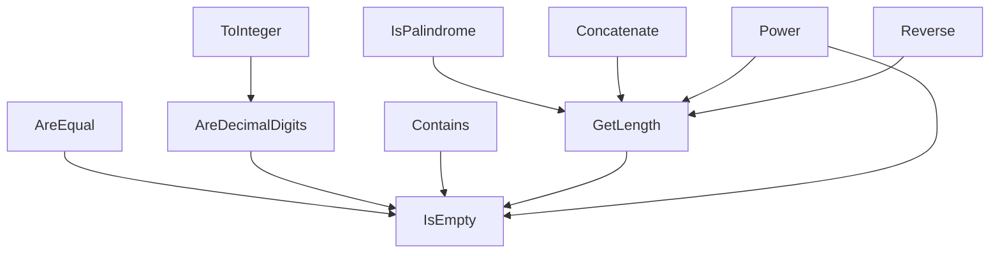

# Strings - Operaciones sobre Σ*

En este documento explicamos las operaciones recursivas sobre cadenas (strings) en teoría de lenguajes formales.

## ¿Qué incluye?

- Definiciones formales
- Ejemplos de uso
- Dependencias entre funciones
- Referencias visuales

## Objetivo

El objetivo es explicar de manera clara y sencilla las operaciones básicas sobre cadenas de caracteres (strings).

## Convenciones

- $\Sigma$ es un alfabeto finito de caracteres.
- $\Sigma^{*}$ es el conjunto de todas las cadenas finitas sobre $\Sigma$.
- $\varepsilon$ es la cadena vacía.
- $h \cdot t$ indica una cadena cuyo primer caracter es $h$ y el sufijo (cola) es $t$.
- $\mathbb{B} = \{\mathbf{true},\mathbf{false}\}$.
- $\mathbb{N}_0$ representa a los números naturales incluyendo el cero.
- $\Sigma_{d} = \{\mathtt{0},\mathtt{1},\ldots,\mathtt{9}\} \subset \Sigma$.

## Cómo leer este documento

- Cada sección define una operación con notación matemática.
- Los bloques en LaTeX muestran casos base y recursivos.
- Los ejemplos muestran resultados concretos.
- El diagrama muestra qué funciones reutilizan otras.

## Índice

| N° | Función | Operación | Clasificación | Dominio | Codominio | Depende de |
| :-: | :--- | :--- | :--- | :--- | :--- | :--- |
| 1 | [IsEmpty](#isempty) | Consulta | Obligatoria | $\Sigma^{*}$ | $\mathbb{B}$ | - |
| 2 | [GetLength](#getlength) | Consulta | Obligatoria | $\Sigma^{*}$ | $\mathbb{N}_0$ | IsEmpty, GetLength |
| 3 | [AreEqual](#areequal) | Consulta | Obligatoria | $\Sigma^{*} \times \Sigma^{*}$ | $\mathbb{B}$ | IsEmpty |
| 4 | [AreDecimalDigits](#aredecimaldigits) | Consulta | Obligatoria | $\Sigma^{*}$ | $\mathbb{B}$ | IsEmpty |
| 5 | [Contains](#contains) | Consulta | Obligatoria | $\Sigma^{*} \times \Sigma$ | $\mathbb{B}$ | IsEmpty |
| 6 | [ToInteger](#tointeger) | Consulta | Obligatoria | $\Sigma_d^{*} \setminus \{\varepsilon\}$ | $\mathbb{N}_0$ | AreDecimalDigits |
| 7 | [IsPalindrome](#ispalindrome) | Consulta | Libre opción | $\Sigma^{*}$ | $\mathbb{B}$ | GetLength |
| 8 | [Concatenate](#concatenate) | Creación o mutación | Crédito extra | $\Sigma^{*} \times \Sigma^{*}$ | $\Sigma^{*}$ | GetLength |
| 9 | [Power](#power) | Creación o mutación | Crédito extra | $\Sigma^{*} \times \mathbb{N}_0$ | $\Sigma^{*}$ | IsEmpty, GetLength |
| 10 | [Reverse](#reverse) | Creación o mutación | Crédito extra & Libre opción | $\Sigma^{*}$ | $\Sigma^{*}$ | GetLength |

## Diagrama de dependencias

Las flechas indican **"dependencia"**: si $A \to B$, entonces $A$ necesita a $B$ en su definición.



> **Nota :** En este grafo, IsEmpty es el único nodo sin dependencias. Por este motivo, puede considerarse la función primitiva sobre la cual se construyen directa o indirectamente las demás funciones del módulo.

---

## IsEmpty

**Definición:** $\text{IsEmpty}: \Sigma^{*} \to \mathbb{B}$

**Descripción:** Devuelve $\mathbf{true}$ si y solo si la cadena no contiene ningún caracter.

$$\text{IsEmpty}(s) =
  \begin{cases}
    \mathbf{true}  & \text{si } s = \varepsilon \\
    \mathbf{false} & \text{si } s = h \cdot t
  \end{cases}$$

> **Nota: Solo existe un caso base.** Esta función no es recursiva: solo distingue entre la cadena vacía y cualquier otra cadena.
En caso de que la función reciba un elemento que **no** pertenezca al dominio, **cortará el ciclo de ejecución del programa.**

**Ejemplos:**

| Llamada | Resultado |
| :--- | :---: |
| $\text{IsEmpty}(\varepsilon)$ | $\mathbf{true}$ |
| $\text{IsEmpty}(\mathtt{abc})$ | $\mathbf{false}$ |
| $\text{IsEmpty}(\mathtt{NULL})$ | $\mathbf{No Definida}$ |
---

## GetLength

**Definición:** $\text{GetLength}: \Sigma^{*} \to \mathbb{N}_0$

**Descripción:** Cuenta los caracteres de la cadena recorriéndola de izquierda a derecha; suma 1 por cada caracter encontrado.

$$\text{GetLength}(s) =
  \begin{cases}
    0 & \text{si } s = \varepsilon \\
    1 + \text{GetLength}(t) & \text{si } s = h \cdot t
  \end{cases}$$

**Ejemplo de traza de ejecución** para $\mathtt{abc}$:

```
GetLength("abc")
  = 1 + GetLength("bc")
  = 1 + 1 + GetLength("c")
  = 1 + 1 + 1 + GetLength("")
  = 1 + 1 + 1 + 0
  = 3
```

---

## AreEqual

**Definición:** $\text{AreEqual}: \Sigma^{*} \times \Sigma^{*} \to \mathbb{B}$

**Descripción:** Compara dos cadenas caracter a caracter. Devuelve $\mathbf{true}$, solo si, tienen la misma longitud y cada par de caracteres en la misma posición es idéntico.

$$\text{AreEqual}(s, p) =
  \begin{cases}
    \mathbf{true}  & \text{si } s = \varepsilon \wedge p = \varepsilon \\
    \mathbf{false} & \text{si } s = \varepsilon \wedge p \neq \varepsilon \\
    \mathbf{false} & \text{si } s \neq \varepsilon \wedge p = \varepsilon \\
    (h_s = h_p) \wedge \text{AreEqual}(t_s, t_p) & \text{si } s = h_s \cdot t_s,\ p = h_p \cdot t_p
  \end{cases}$$

> **Cortocircuito.** Gracias al operador $\wedge$ ("&" o "y"), si $h_s \neq h_p$ la recursión se detiene inmediatamente sin inspeccionar el resto de las cadenas.

**Ejemplo de traza de ejecución** para $\text{AreEqual}(\mathtt{abc}, \mathtt{abd})$:

```
AreEqual("abc", "abd")
  h='a'='a' → true ∧ AreEqual("bc", "bd")
  h='b'='b' → true ∧ AreEqual("c", "d")
  h='c'≠'d' → false
  = false
```

**Ejemplos:**

| Llamada | Resultado |
| :--- | :---: |
| $\text{AreEqual}(\mathtt{abc},\ \mathtt{abc})$ | $\mathbf{true}$ |
| $\text{AreEqual}(\mathtt{abc},\ \mathtt{abd})$ | $\mathbf{false}$ |
| $\text{AreEqual}(\mathtt{abc},\ \mathtt{ab})$ | $\mathbf{false}$ |

---

## AreDecimalDigits

**Definición:** $\text{AreDecimalDigits}: \Sigma^{*} \to \mathbb{B}$

**Descripción:** Verifica que todos los caracteres de la cadena pertenezcan al conjunto de dígitos decimales.

$$
\text{AreDecimalDigits}(s)=
\begin{cases}
\mathbf{true} & \text{si } s=\varepsilon \\
(h \in \Sigma_d)\wedge\text{AreDecimalDigits}(t) & \text{si } s=h\cdot t
\end{cases}
$$

donde

$$
\Sigma_d=\{\mathtt{0},\mathtt{1},\ldots,\mathtt{9}\}.
$$

> **Interpretación:** La función decide si la cadena pertenece al lenguaje $\Sigma_d^{*}$.

> **Verdad vacua / Caso trivial:** El caso $s=\varepsilon$ devuelve $\mathbf{true}$ porque no existe ningún caracter que viole la condición.

**Traza de ejecución** para $\mathtt{12a4}$:

```
AreDecimalDigits("12a4")
  '1' ∈ Σd → true ∧ AreDecimalDigits("2a4")
  '2' ∈ Σd → true ∧ AreDecimalDigits("a4")
  'a' ∉ Σd → false
  = false
```

**Ejemplos:**

| Llamada | Resultado |
| :--- | :---: |
| $\text{AreDecimalDigits}(\varepsilon)$ | $\mathbf{true}$ |
| $\text{AreDecimalDigits}(\mathtt{1234})$ | $\mathbf{true}$ |
| $\text{AreDecimalDigits}(\mathtt{12a4})$ | $\mathbf{false}$ |

---

## Contains

**Definición:** $\text{Contains}: \Sigma^{*} \times \Sigma \to \mathbb{B}$

**Descripción:** Determina si existe alguna posición de la cadena cuyo caracter sea igual a $c$.

$$\text{Contains}(s, c) =
  \begin{cases}
    \mathbf{false} & \text{si } s = \varepsilon \\
    (h = c) \vee \text{Contains}(t, c) & \text{si } s = h \cdot t
  \end{cases}$$

> **Cortocircuito.** Gracias al operador $\vee$, cuando encuentra la primera ocurrencia de $c$, la recursión se detiene sin recorrer el resto de la cadena.

**Traza de ejecución** para $\text{Contains}(\mathtt{abc},\mathtt{b})$:

```text
Contains("abc", 'b')

'a' == 'b' → false ∨ Contains("bc", 'b')
'b' == 'b' → true

Resultado: true
```

**Traza de ejecución** para $\text{Contains}(\mathtt{abc},\mathtt{d})$:

```text
Contains("abc", 'd')

'a' == 'd' → false ∨ Contains("bc", 'd')
'b' == 'd' → false ∨ Contains("c", 'd')
'c' == 'd' → false ∨ Contains("", 'd')
ε → false

Resultado: false
```

**Ejemplos:**

| Llamada | Resultado |
| :--- | :---: |
| $\text{Contains}(\mathtt{abc},\ \mathtt{b})$ | $\mathbf{true}$ |
| $\text{Contains}(\mathtt{abc},\ \mathtt{d})$ | $\mathbf{false}$ |

---

## ToInteger

> **Nota:** Esta función pertenece al módulo **Conversion**, no al módulo **Strings**. Se incluye aquí únicamente por depender de una representación textual de un número entero.

**Definición:** $\text{ToInteger}: \Sigma_d^{*} \setminus \{\varepsilon\} \to \mathbb{N}_0$

**Descripción:** Convierte una cadena compuesta exclusivamente por dígitos decimales en el número natural que representa.

$$
\text{ToInteger}(s)
=
\sum_{i=0}^{|s|-1}
(s[i]-\mathtt{'0'})
\cdot
10^{|s|-1-i}
$$

donde

$$
\Sigma_d=\{\mathtt{0},\mathtt{1},\ldots,\mathtt{9}\}.
$$

> **Precondición:** La cadena no debe estar vacía y todos sus caracteres deben pertenecer a $\Sigma_d$.

> **Implementación:** La función recorre la cadena de izquierda a derecha acumulando el resultado parcial. En cada paso desplaza el valor actual una posición decimal hacia la izquierda (multiplicando por 10) y agrega el valor numérico del nuevo dígito.

**Traza de ejecución** para $\mathtt{142}$:

```text
ToInteger("142")

result = 0

result = 0 * 10 + 1 = 1
result = 1 * 10 + 4 = 14
result = 14 * 10 + 2 = 142

Resultado: 142
```

**Ejemplos:**

| Llamada | Resultado |
| :--- | :---: |
| $\text{ToInteger}(\mathtt{0})$ | $0$ |
| $\text{ToInteger}(\mathtt{7})$ | $7$ |
| $\text{ToInteger}(\mathtt{142})$ | $142$ |
| $\text{ToInteger}(\mathtt{12345})$ | $12345$ |

---

## IsPalindrome

**Definición:** $\text{IsPalindrome}: \Sigma^{*} \to \mathbb{B}$

**Descripción:** Determina si la cadena se lee igual de izquierda a derecha que de derecha a izquierda.

$$
\text{IsPalindrome}(s)=
\begin{cases}
\mathbf{true} & \text{si } \forall i \in \{0,\ldots,\lfloor \frac{|s|}{2}\rfloor-1\} : s[i]=s[|s|-1-i] \\
\mathbf{false} & \text{en otro caso}
\end{cases}
$$

> **Implementación:** La función calcula la longitud de la cadena y compara pares de caracteres simétricos respecto del centro. Si encuentra una diferencia, finaliza inmediatamente devolviendo $\mathbf{false}$.

**Traza de ejecución** para $\mathtt{radar}$:

```text
IsPalindrome("radar")

s[0] == s[4] → 'r' == 'r'
s[1] == s[3] → 'a' == 'a'

Resultado: true
```

**Ejemplos:**

| Llamada | Resultado |
| :--- | :---: |
| $\text{IsPalindrome}(\varepsilon)$ | $\mathbf{true}$ |
| $\text{IsPalindrome}(\mathtt{radar})$ | $\mathbf{true}$ |
| $\text{IsPalindrome}(\mathtt{hola})$ | $\mathbf{false}$ |

---

## Concatenate

**Definición:** $\text{Concatenate}: \Sigma^{*} \times \Sigma^{*} \to \Sigma^{*}$

**Descripción:** Une dos cadenas en una sola copiando los caracteres de $s_{1}$ delante de $s_{2}$, sin modificar ninguna de las dos.

$$\text{Concatenate}(s_{1}, s_{2}) =
  \begin{cases}
    s_{2} & \text{si } s_{1} = \varepsilon \\
    h_{1} \cdot \text{Concatenate}(t_{1}, s_{2}) & \text{si } s_{1} = h_{1} \cdot t_{1}
  \end{cases}$$

> **Nota:** La recursión avanza únicamente sobre $s_{1}$; $s_{2}$ se pasa sin cambios hasta el caso base, donde se "pega" al final. La cadena vacía actúa como **elemento neutro**: $\text{Concatenate}(\varepsilon, s) = s$ y $\text{Concatenate}(s, \varepsilon) = s$.

**Traza de ejecución** para $\text{Concatenate}(\mathtt{ab}, \mathtt{cd})$:

```
Concatenate("ab", "cd")
  = 'a' · Concatenate("b", "cd")
  = 'a' · 'b' · Concatenate("", "cd")
  = 'a' · 'b' · "cd"
  = "abcd"
```
---

## Power

**Definición:** $\text{Power}: \Sigma^{*} \times \mathbb{N}_0 \to \Sigma^{*}$

**Descripción:** Repite la cadena $s$ exactamente $n$ veces, concatenando sucesivas copias.

$$\text{Power}(s, n) =
  \begin{cases}
    \varepsilon & \text{si } n = 0 \\
    \text{Concatenate}(s,\ \text{Power}(s, n-1)) & \text{si } n > 0
  \end{cases}$$

> **Caso base.** $\text{Power}(s, 0) = \varepsilon$ para cualquier $s$, incluso si $s = \varepsilon$. Esto es consistente con la convención $x^{0} = 1$ en aritmética, donde $\varepsilon$ es el neutro de la concatenación.

**Traza de ejecución** para $\text{Power}(\mathtt{ab}, 3)$:

```
Power("ab", 3)
  = Concatenate("ab", Power("ab", 2))
  = Concatenate("ab", Concatenate("ab", Power("ab", 1)))
  = Concatenate("ab", Concatenate("ab", Concatenate("ab", Power("ab", 0))))
  = Concatenate("ab", Concatenate("ab", Concatenate("ab", "")))
  = Concatenate("ab", Concatenate("ab", "ab"))
  = Concatenate("ab", "abab")
  = "ababab"
```

---

## Reverse

**Definición:** $\text{Reverse}: \Sigma^{*} \to \Sigma^{*}$

**Descripción:** Devuelve una nueva cadena cuyos caracteres aparecen en orden inverso respecto de la cadena original.

$$
\text{Reverse}(s)[i] = s[|s|-1-i]
\qquad
\forall i \in \{0,\ldots,|s|-1\}
$$

> **Implementación:** La función calcula la longitud de la cadena y luego recorre los caracteres desde el final hacia el inicio, copiándolos en una nueva cadena.

**Traza de ejecución** para $\mathtt{abc}$:

```text
Reverse("abc")

resultado[0] = 'c'
resultado[1] = 'b'
resultado[2] = 'a'

Resultado: "cba"
```

**Ejemplos:**

| Llamada | Resultado |
| :--- | :---: |
| $\text{Reverse}(\varepsilon)$ | $\varepsilon$ |
| $\text{Reverse}(\mathtt{abc})$ | $\mathtt{cba}$ |
| $\text{Reverse}(\mathtt{radar})$ | $\mathtt{radar}$ |
