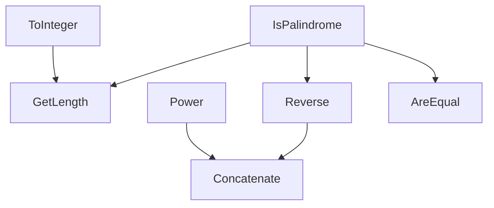

# Strings - Operaciones sobre Σ*

En este documento explicamos las operaciones recursivas sobre cadenas (strings) en teoría de lenguajes formales.

## ¿Qué incluye?

- Definiciones formales
- Ejemplos de uso
- Dependencias entre funciones
- Referencias visuales

## Objetivo

El objetivo es explicar de manera clara y sencilla las operaciones básicas sobre cadenas de símbolos (strings).

## Convenciones

- $\Sigma$ es un alfabeto finito de símbolos.
- $\Sigma^{*}$ es el conjunto de todas las cadenas finitas sobre $\Sigma$.
- $\varepsilon$ es la cadena vacía.
- $h \cdot t$ indica una cadena cuyo primer caracter es $h$ y el sufijo (cola) es $t$.
- $\mathbb{B} = \{\mathbf{true},\mathbf{false}\}$.
- $\mathbb{N}_0$ representa a los números naturales incluyendo el cero.
- $\Sigma_{d} = \{\mathtt{0},\mathtt{1},\ldots,\mathtt{9}\} \subset \Sigma$.

## Cómo leer este documento

- Cada sección define una operación con notación matemática.
- Los bloques en LaTeX muestran casos base y recursivos.
- Los ejemplos muestran resultados concretos.
- El diagrama muestra qué funciones reutilizan otras.

## Índice

| N° | Función | Operación | Clasificación | Dominio | Codominio | Depende de |
| :-: | :--- | :--- | :--- | :--- | :--- | :--- |
| 1 | [IsEmpty](#isempty) | Consulta | Obligatoria | $\Sigma^{*}$ | $\mathbb{B}$ | - |
| 2 | [GetLength](#getlength) | Consulta | Obligatoria | $\Sigma^{*}$ | $\mathbb{N}_0$ | GetLength |
| 3 | [AreEqual](#areequal) | Consulta | Obligatoria | $\Sigma^{*} \times \Sigma^{*}$ | $\mathbb{B}$ | - |
| 4 | [AreDecimalDigits](#aredecimaldigits) | Consulta | Obligatoria | $\Sigma^{*}$ | $\mathbb{B}$ | - |
| 5 | [Contains](#contains) | Consulta | Obligatoria | $\Sigma^{*} \times \Sigma$ | $\mathbb{B}$ | - |
| 6 | [ToInteger](#tointeger) | Consulta | Obligatoria | $\Sigma^{*}$ | $\mathbb{Z}$ | - |
| 7 | [IsPalindrome](#ispalindrome) | Consulta | Libre opción | $\Sigma^{*}$ | $\mathbb{B}$ | AreEqual, Reverse, GetLength |
| 8 | [Concatenate](#concatenate) | Creación o mutación | Crédito extra | $\Sigma^{*} \times \Sigma^{*}$ | $\Sigma^{*}$ | - |
| 9 | [Power](#power) | Creación o mutación | Crédito extra | $\Sigma^{*} \times \mathbb{N}_0$ | $\Sigma^{*}$ | Concatenate |
| 10 | [Reverse](#reverse) | Creación o mutación | Crédito extra & Libre opción | $\Sigma^{*}$ | $\Sigma^{*}$ | Concatenate |

## Diagrama de dependencias

Las flechas indican **"dependencia"**: si $A \to B$, entonces $A$ necesita a $B$ en su definición.



> **Nota :** Las funciones sin aristas entrantes — `IsEmpty`, `AreEqual`, `AreDecimalDigits`, `Contains`, `GetLength`, `Concatenate` — las podemos denominar como **primitivas** porque no reutilizan ninguna otra función.

---

## IsEmpty

**Definición:** $\text{IsEmpty}: \Sigma^{*} \to \mathbb{B}$

**Descripción:** Devuelve $\mathbf{true}$ si y solo si la cadena no contiene ningún símbolo.

$$\text{IsEmpty}(s) =
  \begin{cases}
    \mathbf{true}  & \text{si } s = \varepsilon \\
    \mathbf{false} & \text{si } s = h \cdot t
  \end{cases}$$

> **Nota: Solo existe un caso base.** Esta función no es recursiva: solo distingue entre la cadena vacía y cualquier otra cadena.

**Ejemplos:**

| Llamada | Resultado |
| :--- | :---: |
| $\text{IsEmpty}(\varepsilon)$ | $\mathbf{true}$ |
| $\text{IsEmpty}(\mathtt{abc})$ | $\mathbf{false}$ |

---

## GetLength

**Definición:** $\text{GetLength}: \Sigma^{*} \to \mathbb{N}_0$

**Descripción:** Cuenta los símbolos de la cadena recorriéndola de izquierda a derecha; suma 1 por cada símbolo encontrado.

$$\text{GetLength}(s) =
  \begin{cases}
    0 & \text{si } s = \varepsilon \\
    1 + \text{GetLength}(t) & \text{si } s = h \cdot t
  \end{cases}$$

**Ejemplo de traza de ejecución** para $\mathtt{abc}$:

```
GetLength("abc")
  = 1 + GetLength("bc")
  = 1 + 1 + GetLength("c")
  = 1 + 1 + 1 + GetLength("")
  = 1 + 1 + 1 + 0
  = 3
```

---

## AreEqual

**Definición:** $\text{AreEqual}: \Sigma^{*} \times \Sigma^{*} \to \mathbb{B}$

**Descripción:** Compara dos cadenas símbolo a símbolo. Devuelve $\mathbf{true}$, solo si, tienen la misma longitud y cada par de símbolos en la misma posición es idéntico.

$$\text{AreEqual}(s, p) =
  \begin{cases}
    \mathbf{true}  & \text{si } s = \varepsilon \wedge p = \varepsilon \\
    \mathbf{false} & \text{si } s = \varepsilon \wedge p \neq \varepsilon \\
    \mathbf{false} & \text{si } s \neq \varepsilon \wedge p = \varepsilon \\
    (h_s = h_p) \wedge \text{AreEqual}(t_s, t_p) & \text{si } s = h_s \cdot t_s,\ p = h_p \cdot t_p
  \end{cases}$$

> **Cortocircuito.** Gracias al operador $\wedge$ ("&" o "y"), si $h_s \neq h_p$ la recursión se detiene inmediatamente sin inspeccionar el resto de las cadenas.

**Ejemplo de traza de ejecución** para $\text{AreEqual}(\mathtt{abc}, \mathtt{abd})$:

```
AreEqual("abc", "abd")
  h='a'='a' → true ∧ AreEqual("bc", "bd")
  h='b'='b' → true ∧ AreEqual("c", "d")
  h='c'≠'d' → false
  = false
```

**Ejemplos:**

| Llamada | Resultado |
| :--- | :---: |
| $\text{AreEqual}(\mathtt{abc},\ \mathtt{abc})$ | $\mathbf{true}$ |
| $\text{AreEqual}(\mathtt{abc},\ \mathtt{abd})$ | $\mathbf{false}$ |
| $\text{AreEqual}(\mathtt{abc},\ \mathtt{ab})$ | $\mathbf{false}$ |

---

## AreDecimalDigits

**Definición:** $\text{AreDecimalDigits}: \Sigma^{*} \to \mathbb{B}$

**Descripción:** Verifica que **todos** los símbolos de la cadena sean dígitos decimales. Una cadena vacía satisface trivialmente esta condición.

$$\text{AreDecimalDigits}(s) =
  \begin{cases}
    \mathbf{true} & \text{si } s = \varepsilon \\
    (h \in \Sigma_{d}) \wedge \text{AreDecimalDigits}(t) & \text{si } s = h \cdot t
  \end{cases}$$

> **Verdad vacua / Caso trivial :** El caso $s = \varepsilon$ devuelve $\mathbf{true}$ porque no existe ningún símbolo que viole la condición, por eso decimos que una cadena vacía satisface trivialmente esta condición.

**Ejemplos:**

| Llamada | Resultado |
| :--- | :---: |
| $\text{AreDecimalDigits}(\varepsilon)$ | $\mathbf{true}$ |
| $\text{AreDecimalDigits}(\mathtt{1234})$ | $\mathbf{true}$ |
| $\text{AreDecimalDigits}(\mathtt{12a4})$ | $\mathbf{false}$ |

---

## Contains

**Definición:** $\text{Contains}: \Sigma^{*} \times \Sigma \to \mathbb{B}$

**Descripción:** Indica si el carácter $c$ aparece al menos una vez en la cadena.

$$\text{Contains}(s, c) =
  \begin{cases}
    \mathbf{false} & \text{si } s = \varepsilon \\
    (h = c) \vee \text{Contains}(t, c) & \text{si } s = h \cdot t
  \end{cases}$$

> **Cortocircuito.** Gracias al operador $\vee$, cuando encuentra la primera ocurrencia de $c$, la recursión se detiene sin recorrer el resto de la cadena.

**Ejemplos:**

| Llamada | Resultado |
| :--- | :---: |
| $\text{Contains}(\mathtt{abc},\ \mathtt{b})$ | $\mathbf{true}$ |
| $\text{Contains}(\mathtt{abc},\ \mathtt{d})$ | $\mathbf{false}$ |

---

## ToInteger

**Definición:** $\text{ToInteger}: \Sigma^{*} \to \mathbb{Z}$

**Descripción:** Interpreta una cadena de dígitos decimales como un número entero no negativo, aplicando el sistema posicional con base 10.

Sea $\delta : \Sigma_{d} \to \mathbb{N}_0$ la función que convierte cada dígito en su valor numérico ($\delta(\mathtt{7}) = 7$, etc.).

$$\text{ToInteger}(s) =
  \begin{cases}
    0 & \text{si } s = \varepsilon \\
    \delta(h) \cdot 10^{\text{GetLength}(t)} + \text{ToInteger}(t) & \text{si } s = h \cdot t
  \end{cases}$$

> **Nota:** Esta función tiene comportamiento **indefinido** si la cadena contiene símbolos fuera de $\Sigma_{d}$.

**Traza de ejecución** para $\mathtt{123}$:

```
ToInteger("123")
  = δ('1') · 10^GetLength("23") + ToInteger("23")
  = 1 · 10² + ToInteger("23")
  = 100 + δ('2') · 10^GetLength("3") + ToInteger("3")
  = 100 + 2 · 10¹ + ToInteger("3")
  = 100 + 20 + δ('3') · 10^GetLength("") + ToInteger("")
  = 100 + 20 + 3 · 10⁰ + 0
  = 123
```

---

## IsPalindrome

**Definición:** $\text{IsPalindrome}: \Sigma^{*} \to \mathbb{B}$

**Descripción:** Determina si la cadena es un palíndromo, es decir, si se lee igual de izquierda a derecha que de derecha a izquierda.

**Definición utilizando funciones independientes** :

$$\text{IsPalindrome}(s) = \text{AreEqual}(s,\ \text{Reverse}(s))$$

**Definición recursiva**:

$$\text{IsPalindrome}(s) =
  \begin{cases}
    \mathbf{true}  & \text{si } s = \varepsilon \\
    \mathbf{true}  & \text{si } \text{GetLength}(s) = 1 \\
    \text{IsPalindrome}(t_{\text{medio}}) & \text{si } s = h \cdot t_{\text{medio}} \cdot u \wedge h = u \\
    \mathbf{false} & \text{en otro caso}
  \end{cases}$$

> **Posee 2 casos base:** La cadena vacía y la cadena de un solo símbolo son palíndromos triviales. El paso recursivo compara el primer y el último carácter ($h$ y $u$) y, si coinciden, verifica si el interior $t_{\text{medio}}$ también lo es.

**Traza de ejecución** para $\mathtt{radar}$:

```
IsPalindrome("radar")
  h='r', u='r' → iguales → IsPalindrome("ada")
  h='a', u='a' → iguales → IsPalindrome("d")
  longitud 1 → true
  = true
```

**Ejemplos:**

| Llamada | Resultado |
| :--- | :---: |
| $\text{IsPalindrome}(\varepsilon)$ | $\mathbf{true}$ |
| $\text{IsPalindrome}(\mathtt{radar})$ | $\mathbf{true}$ |
| $\text{IsPalindrome}(\mathtt{hola})$ | $\mathbf{false}$ |

---

## Concatenate

**Definición:** $\text{Concatenate}: \Sigma^{*} \times \Sigma^{*} \to \Sigma^{*}$

**Descripción:** Une dos cadenas en una sola copiando los símbolos de $s_{1}$ delante de $s_{2}$, sin modificar ninguna de las dos.

$$\text{Concatenate}(s_{1}, s_{2}) =
  \begin{cases}
    s_{2} & \text{si } s_{1} = \varepsilon \\
    h_{1} \cdot \text{Concatenate}(t_{1}, s_{2}) & \text{si } s_{1} = h_{1} \cdot t_{1}
  \end{cases}$$

> **Nota:** La recursión avanza únicamente sobre $s_{1}$; $s_{2}$ se pasa sin cambios hasta el caso base, donde se "pega" al final. La cadena vacía actúa como **elemento neutro**: $\text{Concatenate}(\varepsilon, s) = s$ y $\text{Concatenate}(s, \varepsilon) = s$.

**Traza de ejecución** para $\text{Concatenate}(\mathtt{ab}, \mathtt{cd})$:

```
Concatenate("ab", "cd")
  = 'a' · Concatenate("b", "cd")
  = 'a' · 'b' · Concatenate("", "cd")
  = 'a' · 'b' · "cd"
  = "abcd"
```
---

## Power

**Definición:** $\text{Power}: \Sigma^{*} \times \mathbb{N}_0 \to \Sigma^{*}$

**Descripción:** Repite la cadena $s$ exactamente $n$ veces, concatenando sucesivas copias.

$$\text{Power}(s, n) =
  \begin{cases}
    \varepsilon & \text{si } n = 0 \\
    \text{Concatenate}(s,\ \text{Power}(s, n-1)) & \text{si } n > 0
  \end{cases}$$

> **Caso base.** $\text{Power}(s, 0) = \varepsilon$ para cualquier $s$, incluso si $s = \varepsilon$. Esto es consistente con la convención $x^{0} = 1$ en aritmética, donde $\varepsilon$ es el neutro de la concatenación.

**Traza de ejecución** para $\text{Power}(\mathtt{ab}, 3)$:

```
Power("ab", 3)
  = Concatenate("ab", Power("ab", 2))
  = Concatenate("ab", Concatenate("ab", Power("ab", 1)))
  = Concatenate("ab", Concatenate("ab", Concatenate("ab", Power("ab", 0))))
  = Concatenate("ab", Concatenate("ab", Concatenate("ab", "")))
  = Concatenate("ab", Concatenate("ab", "ab"))
  = Concatenate("ab", "abab")
  = "ababab"
```

---

## Reverse

**Definición:** $\text{Reverse}: \Sigma^{*} \to \Sigma^{*}$

**Descripción:** Devuelve una nueva cadena con los símbolos en orden inverso.

$$\text{Reverse}(s) =
  \begin{cases}
    \varepsilon & \text{si } s = \varepsilon \\
    \text{Concatenate}(\text{Reverse}(t),\ h) & \text{si } s = h \cdot t
  \end{cases}$$

> **Nota: esta función posee un patrón de acumulación al final.** En cada paso recursivo, la cabeza $h$ se mueve al final de la cadena revertida. Esto es equivalente a apilar todos los caracteres y luego desapilarlos.

**Traza de ejecución** para $\mathtt{abc}$:

```
Reverse("abc")
  = Concatenate(Reverse("bc"), 'a')
  = Concatenate(Concatenate(Reverse("c"), 'b'), 'a')
  = Concatenate(Concatenate(Concatenate(Reverse(""), 'c'), 'b'), 'a')
  = Concatenate(Concatenate(Concatenate("", 'c'), 'b'), 'a')
  = Concatenate(Concatenate("c", 'b'), 'a')
  = Concatenate("cb", 'a')
  = "cba"
```
