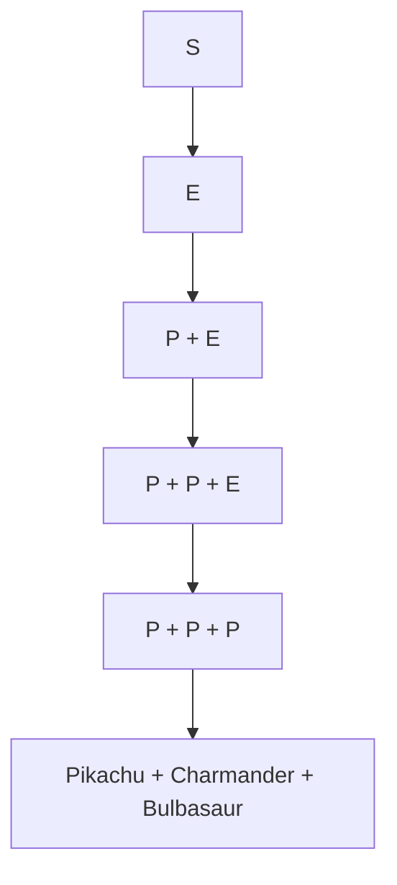
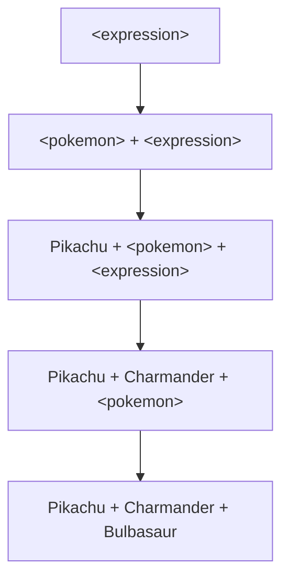
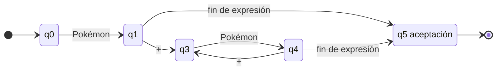
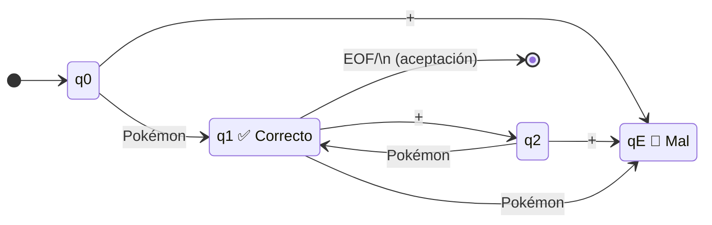
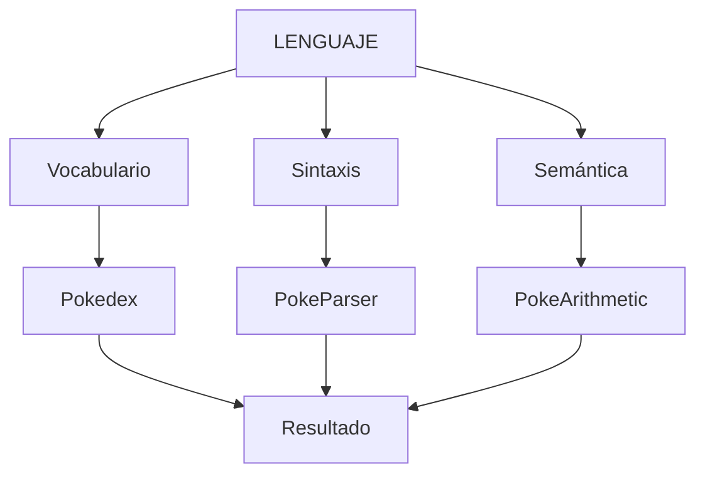

# Definición Formal del Lenguaje — Sumador de Pokémon

## Contenido

1. [Descripción general del proyecto](#1-descripción-general-del-proyecto)
2. [Alfabeto del lenguaje](#2-alfabeto-del-lenguaje)
3. [Definición por extensión](#3-definición-del-lenguaje-por-extensión)
4. [Definición mediante strings y conjuntos](#4-definición-mediante-operaciones-de-strings-y-conjuntos)
5. [Definición mediante Expresiones Regulares](#5-definición-mediante-expresiones-regulares)
6. [Definición mediante RegEx](#6-definición-mediante-regex)
7. [Gramática formal](#7-gramática-formal)
8. [Gramática libre de contexto](#8-gramática-libre-de-contexto)
9. [Definición mediante BNF](#9-definición-mediante-bnf)
10. [BNF extendida (EBNF)](#10-bnf-extendida)
11. [Autómata finito](#11-autómata-finito)
12. [AFD formal](#12-afd-formal)
13. [Ejemplo de recorrido del autómata](#13-ejemplo-de-recorrido-del-autómata)
14. [Correspondencia entre especificación e implementación](#14-correspondencia-entre-la-especificación-y-la-implementación)
15. [Ejemplos de pertenencia al lenguaje](#15-ejemplos-de-pertenencia-al-lenguaje)
16. [Lenguaje vs. semántica](#16-relación-entre-lenguaje-y-operación-aritmética)
17. [Conclusión](#17-conclusión)

---

## 1. Descripción general

El proyecto **SumarX de Pokémon** implementa un lenguaje formal sencillo para representar expresiones aritméticas utilizando nombres de Pokémon de la primera generación como operandos y el símbolo `+` como operador.

Cada Pokémon representa un valor numérico determinado por su posición en la Pokédex. Los primeros 151 Pokémon constituyen los posibles valores del sistema, desde `Mew = 0` hasta `Mewtwo = 150`.

> **Expresiones válidas de ejemplo**
> ```text
> Pikachu
> Pikachu + Charmander
> Bulbasaur + Charmander + Pikachu
> Mewtwo + Pikachu
> ```

El lenguaje permite expresar sumas de una cantidad arbitraria de Pokémon:

```text
Pokemon
Pokemon + Pokemon
Pokemon + Pokemon + Pokemon
...
```

La implementación separa el reconocimiento sintáctico de la operación aritmética mediante un parser y un mecanismo de callback (`OperandConsumer`).

---

## 2. Alfabeto del lenguaje

El alfabeto puede definirse como el conjunto de símbolos utilizados para construir las expresiones.

Sea:

$$
\Sigma = \{P, \; +, \; \text{espacio}, \; \text{\textbackslash n}\}
$$

donde `P` representa los caracteres utilizados para formar nombres de Pokémon.

De manera más precisa, el alfabeto de entrada está constituido por:

| Categoría | Detalle |
| --- | --- |
| Letras | Mayúsculas y minúsculas |
| Caracteres especiales | Presentes en determinados nombres (ver tabla abajo) |
| Operador | El símbolo `+` |
| Separadores | Espacios y otros caracteres de separación permitidos |
| Fin de línea | Salto de línea `\n` |
| Fin de flujo | `EOF` como condición de finalización |

Entre los caracteres especiales se encuentran, por ejemplo:

| Carácter | Aparece en |
| :---: | --- |
| `♀` | `Nidoran♀` |
| `♂` | `Nidoran♂` |
| `.` | `Mr.Mime` |
| `'` | `Farfetch'd` |

---

## 3. Definición del lenguaje por extensión

Una primera forma de definir formalmente el lenguaje consiste en hacerlo **por extensión**, enumerando los elementos que pueden aparecer como operandos.

Sea:

$$
P = \{p_0,p_1,\ldots,p_{150}\}
$$

el conjunto de Pokémon válidos.

El conjunto comienza:

$$
P =
\{
Mew,
Bulbasaur,
Ivysaur,
Venusaur,
Charmander,
\ldots,
Mewtwo
\}
$$

donde cada elemento posee una correspondencia numérica:

$$
f : P \rightarrow \{0,1,\ldots,150\}
$$

| Pokémon | $f(\cdot)$ |
| --- | :---: |
| `Mew` | 0 |
| `Bulbasaur` | 1 |
| `Charmander` | 4 |
| `Pikachu` | 25 |
| `Mewtwo` | 150 |

### 3.1 Conjunto de operadores

$$
O = \{+\}
$$

### 3.2 Conjunto de expresiones

Sea `P` el conjunto de Pokémon y `+` el único operador permitido. Entonces el lenguaje está constituido por expresiones de la forma:

$$
L =
\{p_1\}
\cup
\{p_1 + p_2\}
\cup
\{p_1 + p_2 + p_3\}
\cup \ldots
\qquad p_i \in P
$$

De manera compacta:

$$
\boxed{L = P(+P)^*}
$$

Esta definición establece que una expresión comienza con un Pokémon y puede continuar con cero o más pares `+ Pokémon`.

> **Pertenecen al lenguaje**
> ```text
> Pikachu
> Pikachu + Charmander
> Pikachu + Charmander + Bulbasaur
> Pikachu + Charmander + Bulbasaur + Squirtle
> ```

> **No pertenecen al lenguaje**
> ```text
> +
> Pikachu +
> Pikachu ++ Charmander
> Pikachu Charmander
> ```

---

## 4. Definición mediante operaciones de strings y conjuntos

La implementación puede interpretarse mediante operaciones sobre cadenas y conjuntos.

Sea $P = \{p_0,p_1,\ldots,p_{150}\}$ el conjunto de nombres válidos. Dada una cadena `s`, se define $s \in P$ si y solo si `s` coincide exactamente con alguno de los nombres almacenados en la Pokédex.

En la implementación, esta operación corresponde conceptualmente a:

```c
strcmp(name, pokedex[i]) == 0
```

para algún $0 \leq i < 151$.

| Función C | Definición matemática | Rol |
| --- | :---: | --- |
| `pokemon_to_value(name)` | $f : P \rightarrow \{0,\ldots,150\}$ | Nombre → valor |
| `value_to_pokemon(value)` | $f^{-1} : \{0,\ldots,150\} \rightarrow P$ | Valor → nombre |

`value_to_pokemon` solo está definida cuando el valor pertenece al dominio válido.

---

## 5. Definición mediante Expresiones Regulares

La estructura general del lenguaje puede expresarse mediante una expresión regular.

Definiendo `POKEMON` como cualquier nombre válido de Pokémon:

```text
EXPRESSION = POKEMON ( SPACE* "+" SPACE* POKEMON )*
```

Una expresión regular conceptual sería:

```regex
^[[:space:]]*POKEMON([[:space:]]*\+[[:space:]]*POKEMON)*[[:space:]]*$
```

Donde `POKEMON` debe ser reemplazado por el conjunto de nombres válidos de la Pokédex. Por ejemplo, para representar solamente algunos Pokémon:

```regex
^(Mew|Bulbasaur|Charmander|Pikachu|Mewtwo)([[:space:]]*\+[[:space:]]*(Mew|Bulbasaur|Charmander|Pikachu|Mewtwo))*$
```

> **Permitido por la expresión general**
> ```text
> Pikachu
> Pikachu + Charmander
> Pikachu+Charmander
> Pikachu   +   Charmander
> Pikachu + Charmander + Bulbasaur
> ```

> **Lo que no esta permitido**
> ```text
> + Pikachu
> Pikachu +
> Pikachu ++ Charmander
> Pikachu Charmander
> ```

### 5.1 Observación sobre la implementación

El proyecto **no** depende de una biblioteca de expresiones regulares para realizar el reconocimiento. El parser implementa manualmente una lógica equivalente mediante:

* lectura carácter por carácter;
* identificación de tokens;
* eliminación de espacios;
* detección de `+`;
* validación mediante la Pokédex.

Por lo tanto, la expresión regular representa **una especificación formal del lenguaje**, no necesariamente el mecanismo utilizado en la implementación.

---

## 6. Definición mediante RegEx

Desde una perspectiva equivalente, el lenguaje puede expresarse directamente como:

```regex
^[[:space:]]*(Mew|Bulbasaur|Ivysaur|Venusaur|Charmander|Charmeleon|Charizard|Squirtle|...|Mewtwo)([[:space:]]*\+[[:space:]]*(Mew|Bulbasaur|Ivysaur|Venusaur|Charmander|Charmeleon|Charizard|Squirtle|...|Mewtwo))*[[:space:]]*$
```

El símbolo `...` representa aquí únicamente una abreviación documental del conjunto completo de 151 nombres; para una implementación literal de la expresión regular debería sustituirse por todos los Pokémon válidos.

Una forma más clara de especificarla es mediante una definición auxiliar:

```regex
POKEMON := Mew|Bulbasaur|Ivysaur|...|Mewtwo

EXPRESSION := ^[[:space:]]*POKEMON([[:space:]]*\+[[:space:]]*POKEMON)*[[:space:]]*$
```

Esta notación permite separar:

1. El vocabulario válido de Pokémon.
2. La estructura sintáctica de una expresión.

---

## 7. Gramática Formal

El lenguaje puede definirse mediante una gramática formal:

$$
G=(V,T,P,S)
$$

| Componente | Definición |
| :---: | :---: |
| Variables $V$ | $\{S,E,P\}$ |
| Símbolo inicial | $S$ |
| Terminales $T$ | Nombres de Pokémon, `+`, espacios |

### Producciones

$$
S \rightarrow E
\qquad
E \rightarrow P
\qquad
E \rightarrow P + E
\qquad
(P \in Pokedex)
$$

Esta gramática representa expresiones con uno o más operandos. Por ejemplo, `Pikachu + Charmander + Bulbasaur` se deriva como:



(sustituyendo posteriormente cada `P` por un Pokémon concreto)

---

## 8. Gramática libre de contexto

Una representación más explícita puede utilizar:

```text
<EXPRESION> ::= <POKEMON>
              | <POKEMON> "+" <EXPRESION>

<POKEMON> ::= "Mew"
            | "Bulbasaur"
            | "Ivysaur"
            | "Venusaur"
            | ...
            | "Mewtwo"
```

`<EXPRESION>` representa una expresión completa y `<POKEMON>` representa un operando válido.

Esta gramática es **libre de contexto**, ya que cada producción posee un único símbolo no terminal en su lado izquierdo.

---

## 9. Definición mediante BNF

La misma gramática puede expresarse mediante **Backus-Naur Form (BNF)**:

```bnf
<expression> ::= <pokemon>
               | <pokemon> "+" <expression>

<pokemon> ::= "Mew"
            | "Bulbasaur"
            | "Ivysaur"
            | "Venusaur"
            | "Charmander"
            | "Charmeleon"
            | "Charizard"
            | "Squirtle"
            | ...
            | "Mewtwo"
```

La notación `<expression> ::= <pokemon> "+" <expression>` permite generar una cantidad arbitraria de operandos. Por ejemplo, `Pikachu + Charmander + Bulbasaur` se genera mediante:



---

## 10. BNF extendida

Para simplificar la representación, también puede utilizarse EBNF:

```ebnf
expression = pokemon, { "+", pokemon } ;
```

Esta definición es equivalente a:

```text
pokemon
pokemon + pokemon
pokemon + pokemon + pokemon
...
```

El operador `{ }` indica repetición cero o más veces. La definición completa puede expresarse conceptualmente como:

```ebnf
expression = pokemon, { whitespace, "+", whitespace, pokemon } ;

pokemon = "Mew"
        | "Bulbasaur"
        | "Ivysaur"
        | ...
        | "Mewtwo" ;
```

---

## 11. Autómata Finito

El lenguaje también puede ser reconocido mediante un **Autómata Finito Determinista (AFD)**.

### 11.1 Versión detallada (6 estados)

| Estado | Significado |
| :---: | --- |
| $q_0$ | inicio / esperando Pokémon |
| $q_1$ | leyendo Pokémon |
| $q_2$ | esperando operador o fin |
| $q_3$ | esperando Pokémon después de `+` |
| $q_4$ | leyendo siguiente Pokémon |
| $q_5$ | aceptación |
| $q_e$ | error |



> Cualquier transición no contemplada en el diagrama lleva al estado de error $q_e$ (omitido por claridad visual).

### 11.2 Versión simplificada (3 estados)

Una simplificación equivalente utiliza solamente tres estados principales:

| Estado | Significado |
| :---: | --- |
| $q_0$ | esperando Pokémon |
| $q_1$ | esperando `+` |
| $q_2$ | esperando Pokémon (tras `+`) |



Esta es la versión que se utiliza como base formal en las secciones siguientes.

---

## 12. AFD formal

El autómata puede definirse formalmente como:

$$
A=(Q,\Sigma,\delta,q_0,F)
$$

| Componente | Definición |
| :---: | :---: |
| $Q$ | $\{q_0,q_1,q_2,q_e\}$ |
| Estado inicial | $q_0$ |
| $F$ | $\{q_1\}$ |

| Estado | Significado |
| :---: | --- |
| $q_0$ | esperando un Pokémon |
| $q_1$ | se recibió un Pokémon; se espera `+` o fin |
| $q_2$ | se recibió `+`; se espera un Pokémon |
| $q_e$ | estado de error |

### Transiciones principales

$$
\delta(q_0,P)=q_1
\qquad
\delta(q_1,+)=q_2
\qquad
\delta(q_2,P)=q_1
$$

donde `P` representa cualquier Pokémon válido.

El fin de línea o `EOF` desde $q_1$ produce aceptación. Cualquier otra combinación no válida conduce al estado de error.

---

## 13. Ejemplo de recorrido del autómata

> [!TIP]
> **Aceptado:** `Pikachu + Charmander`
>
> ```mermaid
> flowchart LR
>     q0((q0)) -- Pikachu --> q1((q1))
>     q1 -- + --> q2((q2))
>     q2 -- Charmander --> q1b((q1))
>     q1b -- EOF/\n --> A["✅ ACEPTACIÓN ✅"]
>     style q1b stroke:#2ecc71,stroke-width:3px
>     style A stroke:#2ecc71,stroke-width:3px
> ```

> **Rechazado:** `Pikachu +`
>
> ```mermaid
> flowchart LR
>     q0((q0)) -- Pikachu --> q1((q1))
>     q1 -- + --> q2((q2))
>     q2 -- EOF/\n --> E["🔴 ERROR 🔴"]
>     style E stroke:#e74c3c,stroke-width:3px
> ```

> **Rechazado:** `Pikachu ++ Charmander`
>
> ```mermaid
> flowchart LR
>     q0((q0)) -- Pikachu --> q1((q1))
>     q1 -- + --> q2((q2))
>     q2 -- + --> E["🔴 ERROR 🔴"]
>     style E stroke:#e74c3c,stroke-width:3px
> ```

---

## 14. Correspondencia entre la especificación y la implementación

Las diferentes definiciones representan el mismo lenguaje desde distintas perspectivas:

| Método | Qué describe |
| --- | --- |
| Extensión | Los elementos concretos del vocabulario |
| Strings y conjuntos | La pertenencia de un token al conjunto de Pokémon |
| Expresión regular | El patrón general de una expresión |
| RegEx | La representación operacional del patrón |
| Gramática formal | Las reglas de generación del lenguaje |
| BNF | La gramática mediante una notación estandarizada |
| Autómata finito | El reconocimiento secuencial del lenguaje |

El proyecto implementa principalmente el reconocimiento mediante un **parser determinista carácter por carácter**, cuya lógica es equivalente a la del autómata definido anteriormente.

---

## 15. Ejemplos de pertenencia al lenguaje

> **Expresiones válidas**
> ```text
> Mew
> Pikachu
> Pikachu + Charmander
> Pikachu+Charmander
> Pikachu + Charmander + Bulbasaur
> Mew + Pikachu
> Mewtwo + Pikachu
> ```

> **Expresiones inválidas**
> ```text
> +
> + Pikachu
> Pikachu +
> Pikachu ++ Charmander
> Pikachu Charmander
> PokemonInexistente
> Pikachu + PokemonInexistente
> ```

---

## 16. Relación entre lenguaje y operación aritmética

Es importante separar dos conceptos:

| Concepto | Pregunta que responde | Ejemplo |
| --- | --- | --- |
| **Lenguaje** | ¿Está la expresión correctamente formada? | `Pikachu + Charmander + Bulbasaur` |
| **Semántica** | ¿Qué significa esa expresión? | mediante $f(\text{Pokemon}) = \text{valor}$ |

Aplicando $f$:

| Pokémon | Valor |
| --- | :---: |
| `Pikachu` | 25 |
| `Charmander` | 4 |
| `Bulbasaur` | 1 |

la expresión `Pikachu + Charmander + Bulbasaur` adquiere la interpretación:

$$
25+4+1=30
$$

El resultado se almacena utilizando la representación numérica definida por el proyecto, basada en **base 151**.

---

## 17. Conclusión

El lenguaje que creamos puede describirse formalmente desde los diferentes niveles de abstracción:

- **Por extensión**, mediante el conjunto de los 151 Pokémon válidos.
- **Mediante strings y conjuntos**, estableciendo la pertenencia de cada token al vocabulario.
- **Mediante expresiones regulares**, describiendo el patrón sintáctico general.
- **Mediante gramática formal y BNF**, especificando las reglas de generación del lenguaje.
- **Mediante un AFD**, ya que el reconocimiento de una expresión requiere únicamente información finita sobre si se espera un Pokémon, un operador o el final de la expresión.

La implementación concreta del proyecto sigue esta misma estructura conceptual:



De esta manera, el proyecto no solamente implementa un sumador, sino un pequeño lenguaje formal con un vocabulario definido, una sintaxis especificada matemáticamente, un mecanismo de reconocimiento y una semántica asociada a la operación de suma.
