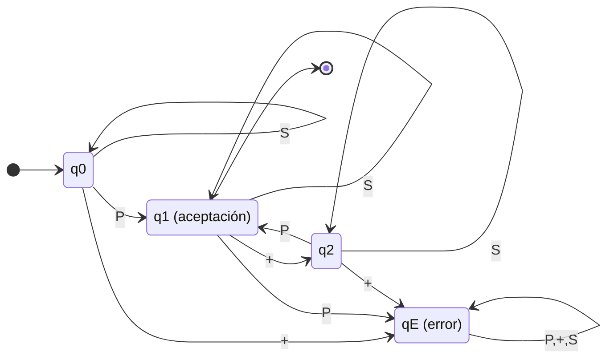
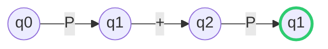
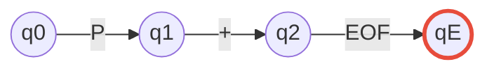
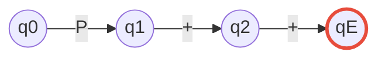
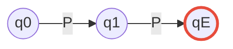
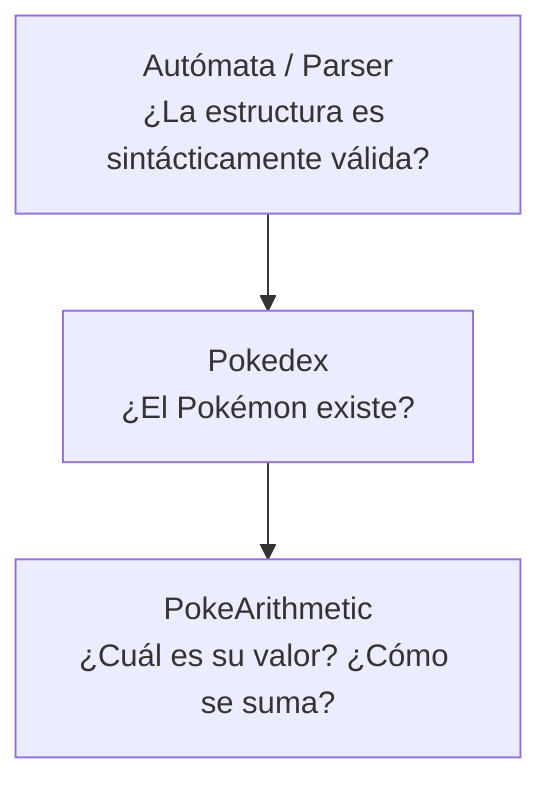

# Formalización del Autómata Finito de SumarX

El lenguaje del **Sumador de Pokémon** puede ser reconocido mediante un **Autómata Finito Determinista (AFD)**.

## Contenido

1. [Conjunto de estados](#1-conjunto-de-estados)
2. [Alfabeto de entrada](#2-alfabeto-de-entrada)
3. [Función de transición](#3-función-de-transición)
4. [Estado inicial](#4-estado-inicial)
5. [Estados de aceptación](#5-estados-de-aceptación)
6. [Formalización completa](#6-formalización-completa)
7. [Ejemplo de aceptación](#7-ejemplo-de-aceptación)
8. [Ejemplo de rechazo: operador al final](#8-ejemplo-de-rechazo-operador-al-final)
9. [Ejemplo de rechazo: operadores consecutivos](#9-ejemplo-de-rechazo-operadores-consecutivos)
10. [Ejemplo de rechazo: dos Pokémon consecutivos](#10-ejemplo-de-rechazo-dos-pokémon-consecutivos)
11. [Relación con el parser](#11-relación-con-el-parser)
12. [Alcance del autómata](#12-alcance-del-autómata)
13. [Resumen de errores](#13-resumen-de-errores)

---

Formalmente, un AFD se define como una **5-upla**:

$$
A = (Q, \Sigma, \delta, q_0, F)
$$

donde:

$$
\begin{array}{l}
Q \quad\text{es el conjunto finito de estados}\\
\Sigma \quad\text{es el alfabeto de entrada}\\
\delta \quad\text{es la función de transición}\\
q_0 \quad\text{es el estado inicial}\\
F \quad\text{es el conjunto de estados finales o de aceptación}
\end{array}
$$

---

## 1. Conjunto de estados

Para el lenguaje definido se utilizan cuatro estados:

$$
Q=\{q_0,q_1,q_2,q_E\}
$$

Cada estado representa una situación sintáctica determinada:

| Estado | Descripción |
| :---: | --- |
| $q_0$ | Estado inicial. Se espera un Pokémon. |
| $q_1$ | Se recibió un Pokémon. Se espera `+` o el final de la expresión. |
| $q_2$ | Se recibió `+`. Se espera otro Pokémon. |
| $q_E$ | Estado de error. |

---

## 2. Alfabeto de entrada

Para simplificar el modelo, los caracteres de entrada se agrupan en categorías:

$$
\Sigma=\{P,+,S\}
$$

donde:

* $P$: cualquier Pokémon válido perteneciente al conjunto de los 151 Pokémon.
* `+`: operador de suma.
* $S$: espacio en blanco.

Por lo tanto:

$$
P \in
\{
Mew,
Bulbasaur,
Ivysaur,
\ldots,
Mewtwo
\}
$$

No se representan individualmente los 151 nombres dentro del autómata, sino que todos se abstraen mediante el símbolo $P$.

Esto permite trabajar a nivel de **tokens**, en lugar de construir un autómata extremadamente grande que reconozca cada Pokémon carácter por carácter.

> **Nota:** `EOF` y `\n` representan condiciones de finalización de una expresión y no necesariamente símbolos pertenecientes al alfabeto $\Sigma$. Por este motivo se tratan como condiciones especiales de aceptación.

---

## 3. Función de transición

La función de transición se define como:

$$
\delta:Q\times\Sigma\rightarrow Q
$$

La tabla de transición es:

| Estado | Pokémon $P$ | `+` | Espacio $S$ |
| :---: | :---: | :---: | :---: |
| $q_0$ | $q_1$ | $q_E$ | $q_0$ |
| $q_1$ | $q_E$ | $q_2$ | $q_1$ |
| $q_2$ | $q_1$ | $q_E$ | $q_2$ |
| $q_E$ | $q_E$ | $q_E$ | $q_E$ |

De forma visual, el diagrama de estados completo (incluyendo autotransiciones por espacio $S$) es el siguiente:



Las transiciones principales pueden expresarse formalmente como:

$$
\delta(q_0,P)=q_1
\qquad
\delta(q_1,+)=q_2
\qquad
\delta(q_2,P)=q_1
$$

Mientras que las transiciones correspondientes a espacios son:

$$
\delta(q_0,S)=q_0
\qquad
\delta(q_1,S)=q_1
\qquad
\delta(q_2,S)=q_2
$$

Cualquier combinación sintácticamente inválida conduce al estado de error:

$$
\delta(q_E,x)=q_E \quad \text{para todo } x\in\Sigma
$$

---

## 4. Estado inicial

El estado inicial es:

$$
q_0
$$

El autómata comienza esperando recibir un Pokémon.

Por ejemplo:

```text
q0 → Pikachu → q1
```

---

## 5. Estados de aceptación

El conjunto de estados finales es:

$$
F=\{q_1\}
$$

El único estado de aceptación es $q_1$, dado que una expresión válida debe finalizar inmediatamente después de un Pokémon.

> **Ejemplo simple — aceptado**
>
> ```text
> Pikachu
> ```
>
> $$q_0 \xrightarrow{P} q_1 \qquad \Rightarrow \qquad q_1\in F$$

También puede finalizar una expresión después de varios operandos:

> **Ejemplo con múltiples operandos — aceptado**
>
> ```text
> Pikachu + Charmander + Bulbasaur
> ```
>
> $$
> q_0
> \xrightarrow{P} q_1
> \xrightarrow{+} q_2
> \xrightarrow{P} q_1
> \xrightarrow{+} q_2
> \xrightarrow{P} q_1
> $$
>
> Nuevamente $q_1\in F$, por lo que la expresión es aceptada.

---

## 6. Formalización completa

Por lo tanto, el Autómata Finito Determinista queda definido como:

$$
\boxed{A=(Q,\Sigma,\delta,q_0,F)}
$$

| Componente | Definición |
| :---: | :---: |
| $Q$ | $\{q_0,q_1,q_2,q_E\}$ |
| $\Sigma$ | $\{P,+,S\}$ |
| $q_0$ | $q_0$ |
| $F$ | $\{q_1\}$ |

y la función de transición:

$$
\begin{array}{c|ccc}
\delta & P & + & S\\
\hline
q_0 & q_1 & q_E & q_0\\
q_1 & q_E & q_2 & q_1\\
q_2 & q_1 & q_E & q_2\\
q_E & q_E & q_E & q_E
\end{array}
$$

---

## 7. Ejemplo de aceptación

Consideremos la expresión:

```text
Pikachu + Charmander
```

A nivel del autómata se abstrae como:

```text
P + P
```

El recorrido es:



Como $q_1\in F$, la cadena es **aceptada**.

---

## 8. Ejemplo de rechazo: operador al final

Consideremos:

```text
Pikachu +
```

A nivel del autómata:

```text
P +
```

El recorrido es:



El estado $q_2$ indica que se está esperando un Pokémon. Al encontrar el final de la expresión sin recibirlo, la expresión es rechazada.

> **Error:** `PARSE_TRAILING_PLUS`

---

## 9. Ejemplo de rechazo: operadores consecutivos

Consideremos:

```text
Pikachu ++ Charmander
```

A nivel del autómata:

```text
P + + P
```

El recorrido es:



La transición $\delta(q_2,+)=q_E$ indica que no es posible encontrar otro operador mientras el autómata está esperando un Pokémon.

> **Error:** `PARSE_EMPTY_OPERAND`

---

## 10. Ejemplo de rechazo: dos Pokémon consecutivos

Consideremos:

```text
Pikachu Charmander
```

A nivel del autómata:

```text
P P
```

El recorrido es:



La transición $\delta(q_1,P)=q_E$ representa que, una vez leído un Pokémon, debe aparecer un operador `+` antes de poder recibir otro Pokémon.

> **Error:** `PARSE_SYNTAX_ERROR`

---

## 11. Relación con el parser

El autómata representa el comportamiento sintáctico abstracto implementado por `PokeParser`.

El parser mantiene internamente una lógica equivalente a los estados del autómata mediante la variable:

```c
bool expect_operand;
```

| Variable del parser | Estado equivalente del autómata |
| --- | :---: |
| `expect_operand == true` (comenzando expresión) | $q_0$ |
| `expect_operand == true` (tras un `+`) | $q_2$ |
| `expect_operand == false` (tras un Pokémon) | $q_1$ |

Cuando `expect_operand == false`, el parser acaba de procesar un Pokémon y espera `+`, espacios o el final de la expresión.

Por lo tanto, el autómata constituye una **representación formal del comportamiento sintáctico del parser**, mientras que la implementación concreta utiliza lectura carácter por carácter y validación mediante la Pokédex.

---

## 12. Alcance del autómata

El autómata presentado representa la **estructura sintáctica abstracta** del lenguaje:

```text
Pokémon (+ Pokémon)*
```

No representa individualmente los caracteres que componen cada nombre. Por ejemplo, el autómata considera `Pikachu`, `Charmander` y `Mewtwo` como instancias diferentes del mismo símbolo abstracto $P$.

La validación de que cada token pertenece efectivamente al conjunto de Pokémon válidos es responsabilidad del módulo `Pokedex`, mediante:

```c
pokemon_to_value()
```

De esta manera se separan tres responsabilidades:



Esta separación permite mantener independiente la **sintaxis del lenguaje**, el **vocabulario válido** y la **semántica aritmética**.

---

## 13. Resumen de errores

Tabla de referencia rápida con todos los casos de rechazo cubiertos:

| Código de error | Transición que lo dispara | Causa |
| --- | :---: | --- |
| `PARSE_TRAILING_PLUS` | $q_2 \xrightarrow{\text{EOF}} q_E$ | La expresión termina justo después de un `+`. |
| `PARSE_EMPTY_OPERAND` | $\delta(q_2,+)=q_E$ | Dos operadores `+` consecutivos. |
| `PARSE_SYNTAX_ERROR` | $\delta(q_1,P)=q_E$ | Dos Pokémon consecutivos sin `+` entre ellos. |
