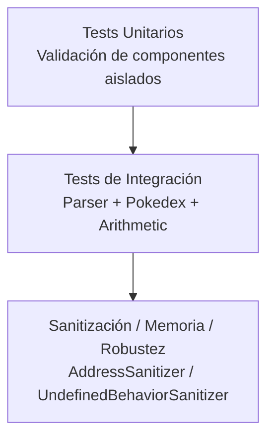
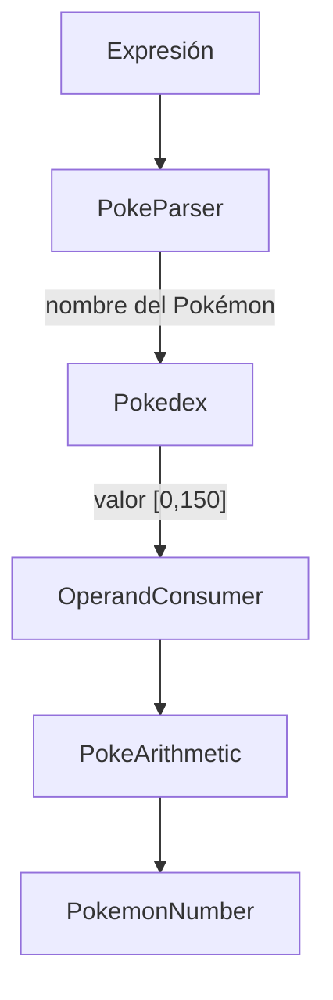
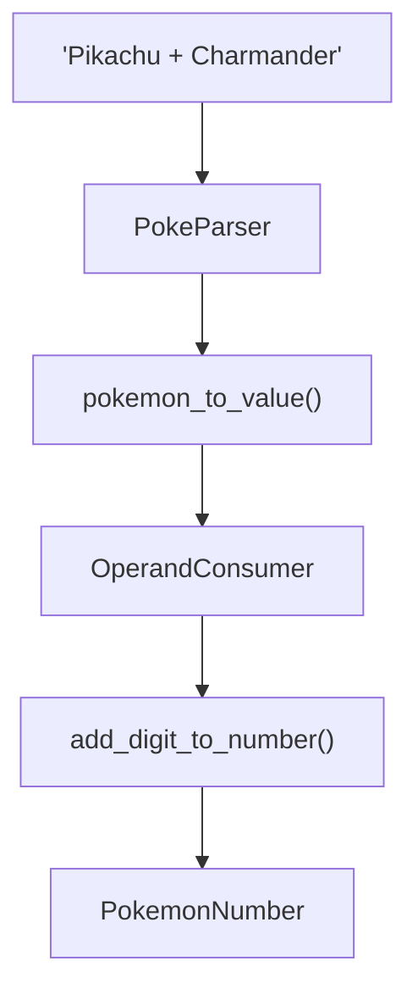
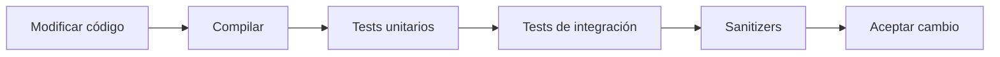
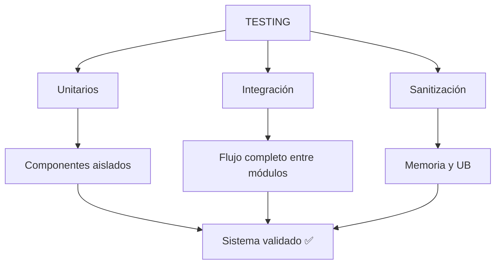

# Estrategia de Testing — SumarX de Pokémon

## Contenido

1. [Introducción](#1-introducción)
2. [Objetivos del testing](#2-objetivos-del-testing)
3. [Arquitectura bajo prueba](#3-arquitectura-bajo-prueba)
4. [Tests unitarios](#4-tests-unitarios)
5. [Tests de integración](#5-tests-de-integración)
6. [Prueba de representación en base 151](#6-prueba-de-representación-en-base-151)
7. [Caso especial: Mew como cero](#7-caso-especial-mew-como-cero)
8. [Integración con errores](#8-integración-con-errores)
9. [Resultado de los tests de integración](#9-resultado-de-los-tests-de-integración)
10. [Gestión de memoria y comportamiento indefinido](#10-gestión-de-memoria-y-comportamiento-indefinido)
11. [Pruebas de regresión](#11-pruebas-de-regresión)
12. [Cobertura funcional alcanzada](#12-cobertura-funcional-alcanzada)
13. [Conclusión](#13-conclusión)

---

## 1. Introducción

El proyecto **SumarX de Pokémon** implementa un sistema capaz de interpretar expresiones matemáticas cuyos operandos son nombres de Pokémon de la primera generación.

Cada Pokémon representa un valor numérico según su posición en la Pokédex:

| Pokémon | Valor |
| --- | :---: |
| `Bulbasaur` | 1 |
| `Charmander` | 4 |
| `Pikachu` | 25 |
| `Mewtwo` | 150 |

Los resultados se representan utilizando **base 151**, aprovechando los 151 Pokémon disponibles como dígitos.

> El Pokémon `Mew` representa el `0`, ya que todos los Pokémon parten de Mew y, además, la suma necesita de un elemento neutro.

La estrategia de testing se diseñó para validar el sistema progresivamente, desde sus componentes individuales hasta la integración completa entre parser, Pokédex y módulo aritmético.

---

## 2. Objetivos del testing

Los principales objetivos de la estrategia son:

- Verificar el comportamiento individual de cada módulo.
- Validar el procesamiento correcto de expresiones.
- Comprobar la interacción entre los diferentes componentes.
- Detectar errores en entradas inválidas.
- Verificar el manejo de la representación numérica en base 151.
- Detectar problemas relacionados con memoria y comportamiento indefinido.
- Garantizar que los cambios realizados no rompan funcionalidades existentes.

La estrategia se divide en tres niveles principales:



---

## 3. Arquitectura bajo prueba

El procesamiento de una expresión sigue el siguiente flujo:



El diseño utiliza un **callback (`OperandConsumer`)** para desacoplar el parser de la operación que se realiza sobre cada operando.

La interfaz utilizada es:

```c
typedef bool (*OperandConsumer)(int16_t value, void *context);
```

De esta forma, el parser no necesita conocer cómo se acumulan o procesan los valores.

---

## 4. Tests unitarios

Los tests unitarios constituyen la primera capa de validación. Su objetivo es verificar el comportamiento de los componentes de forma aislada, sin depender de la integración completa del sistema.

### 4.1 Parser

El parser fue probado mediante casos correspondientes a las distintas situaciones que puede encontrar durante el procesamiento de una expresión.

> **Expresiones válidas**
> ```text
> Pikachu
> Pikachu + Charmander
> Pikachu + Charmander + Bulbasaur
> Pikachu+Charmander
> Pikachu   +   Charmander
> ```

> **Expresiones inválidas**
> ```text
> +
> Pikachu +
> Pikachu ++ Charmander
> Pikachu Charmander
> ```

También se verificaron casos como: línea vacía, `EOF`, Pokémon inexistente, Pokémon con nombre demasiado largo, operandos vacíos, espacios, operadores consecutivos, operador al comienzo y operador al final.

Dos casos particularmente importantes:

| Entrada | Error esperado |
| --- | --- |
| `Pikachu +` | `PARSE_TRAILING_PLUS` |
| `Pikachu ++ Charmander` | `PARSE_EMPTY_OPERAND` |

Esto permite comprobar que diferentes errores sintácticos sean distinguidos correctamente.

---

## 5. Tests de integración

Una vez completados los tests unitarios, se incorporaron tests de integración. A diferencia de los tests unitarios, estos no buscan comprobar una función aislada, sino verificar que los principales módulos funcionen correctamente en conjunto.

El flujo probado es:



Los tests se encuentran en:

```text
tests/TestPokeIntegracion.c
```

### 5.1 Casos de suma simple

Los siguientes casos verifican el flujo completo desde la entrada textual hasta la representación numérica final, incluyendo reconocimiento de operandos, conversión a valores, procesamiento mediante el callback y acumulación aritmética:

| Expresión | Valores | Cálculo | `digits` esperado |
| --- | --- | :---: | :---: |
| `Pikachu` | Pikachu = 25 | — | `[25]` |
| `Pikachu + Charmander` | Pikachu = 25, Charmander = 4 | $25+4$ | `[29]` |
| `Bulbasaur + Charmander + Pikachu` | Bulbasaur = 1, Charmander = 4, Pikachu = 25 | $1+4+25$ | `[30]` |

El caso de `Bulbasaur + Charmander + Pikachu` además comprueba que el parser entrega cada operando individualmente al consumidor y que el acumulador mantiene correctamente el estado entre llamadas.

---

## 6. Prueba de representación en base 151

Uno de los casos de integración más importantes es la verificación del **carry en base 151**.

Se utiliza:

```text
Mewtwo + Pikachu
```

donde `Mewtwo = 150` y `Pikachu = 25`. La suma es $150+25=175$.

Como el sistema utiliza base 151:

$$
175 = 1 \times 151 + 24
$$

Por lo tanto, la representación interna esperada es `digits = [24, 1]`, donde `digits[0] = 24` (dígito menos significativo) y `digits[1] = 1` (acarreo).

> Este test resulta particularmente relevante porque verifica que la integración no solamente produzca sumas simples, sino que también funcione correctamente cuando se produce un **acarreo entre dígitos**.

---

## 7. Caso especial: Mew como cero

En el sistema, `Mew = 0`. Por lo tanto:

| Expresión | Cálculo | `digits` esperado |
| --- | :---: | :---: |
| `Mew + Pikachu` | $0+25$ | `[25]` |

Este caso valida el tratamiento del valor cero dentro del sistema aritmético.

---

## 8. Integración con errores

La integración también contempla expresiones inválidas:

| Caso | Entrada | Resultado esperado |
| --- | --- | --- |
| Operador al final | `Pikachu +` | `PARSE_TRAILING_PLUS` |
| Pokémon inexistente | `Pikachu + PokemonInexistente` | `PARSE_INVALID_POKEMON` |
| Operadores consecutivos | `Pikachu ++ Charmander` | `PARSE_EMPTY_OPERAND` |

El caso de Pokémon inexistente verifica que el error generado por la Pokédex sea correctamente propagado por el parser. El de operadores consecutivos verifica la interacción entre la validación sintáctica y el procesamiento de operandos.

---

## 9. Resultado de los tests de integración

La suite de integración contiene actualmente los siguientes escenarios:

| Test | Descripción | Resultado |
| --- | --- | :---: |
| `test_single_pokemon` | Procesamiento de un Pokémon | ✅ Correcto |
| `test_two_pokemon` | Suma de dos Pokémon | ✅ Correcto |
| `test_multiple_pokemon` | Suma de múltiples Pokémon | ✅ Correcto |
| `test_base_151_carry` | Acarreo en base 151 | ✅ Correcto |
| `test_mew_as_zero` | Tratamiento de Mew como cero | ✅ Correcto |
| `test_trailing_plus` | Operador al final | ✅ Correcto |
| `test_invalid_pokemon` | Pokémon inexistente | ✅ Correcto |
| `test_consecutive_plus` | Operadores consecutivos | ✅ Correcto |

La ejecución completa siempre finaliza con un mensaje de éxito.

---

## 10. Gestión de memoria y comportamiento indefinido

Dado que el proyecto está implementado en C, además de comprobar la lógica funcional resulta importante verificar el manejo de memoria.

El módulo `PokeArithmetic` utiliza memoria dinámica para representar `PokemonNumber`:

```c
PokemonNumber *num = malloc(sizeof(*num));
```

y posteriormente reserva espacio para sus dígitos:

```c
num->digits = calloc(...);
```

Por este motivo se recomienda ejecutar la suite utilizando herramientas de sanitización.

### AddressSanitizer

La compilación puede realizarse utilizando:

```bash
gcc -fsanitize=address,undefined -g ...
```

Esto permite detectar problemas tales como:

- [ ] Accesos fuera de límites
- [ ] Use-after-free
- [ ] Double-free
- [ ] Errores de memoria
- [ ] Comportamiento indefinido

---

## 11. Pruebas de regresión

Los tests desarrollados también pueden utilizarse como una **suite de regresión**.

Cada modificación realizada sobre `PokeParser`, `Pokedex` o `PokeArithmetic` debería ser seguida por la ejecución completa de los tests. El objetivo es garantizar que una modificación en un módulo no introduzca errores en otro.



---

## 12. Cobertura funcional alcanzada

La estrategia desarrollada permite verificar:

### Parser

- [x] Pokémon individuales
- [x] Múltiples operandos
- [x] Operadores `+`
- [x] Espacios
- [x] Líneas vacías
- [x] EOF
- [x] Operandos vacíos
- [x] Operador al comienzo
- [x] Operador al final
- [x] Operadores consecutivos
- [x] Pokémon inexistentes
- [x] Tokens demasiado largos
- [x] Errores de lectura
- [x] Errores del callback

### Pokedex

- [x] Conversión Pokémon → valor
- [x] Conversión valor → Pokémon
- [x] Valores válidos
- [x] Valores inválidos
- [x] Mew como valor `0`
- [x] Mewtwo como valor `150`
- [x] Rechazo de `MissingNo.`

### Arithmetic

- [x] Creación del número
- [x] Liberación de memoria
- [x] Adición de operandos
- [x] Acumulación
- [x] Crecimiento dinámico
- [x] Representación en base 151
- [x] Carry
- [x] Normalización
- [x] Impresión
- [x] Validación de dígitos

### Integración

- [x] Parser + Pokedex
- [x] Parser + Arithmetic
- [x] Pokedex + Arithmetic
- [x] Flujo completo de una expresión
- [x] Manejo de errores entre módulos
- [x] Representación final del resultado
- [x] Carry en base 151

---

## 13. Conclusión

La estrategia de testing que implementamos permite validar el sistema en diferentes niveles de abstracción.

Los **tests unitarios** garantizan el correcto funcionamiento de los componentes individuales, mientras que los **tests de integración** verifican que estos componentes puedan trabajar correctamente como un único sistema.

El caso de integración de base 151 resulta especialmente importante porque permite comprobar una característica central del proyecto: la utilización de los primeros 151 Pokémon como representación de los dígitos del sistema numérico.

Finalmente, la utilización de **AddressSanitizer/UndefinedBehaviorSanitizer** permite complementar las pruebas funcionales con controles específicos para un lenguaje de bajo nivel como C.

En conjunto, la estrategia queda estructurada de la siguiente manera:



Con esta estructura, el proyecto cuenta con una estrategia de testing suficiente para validar tanto la lógica individual de sus módulos como el comportamiento integrado del sumador de Pokémon.
