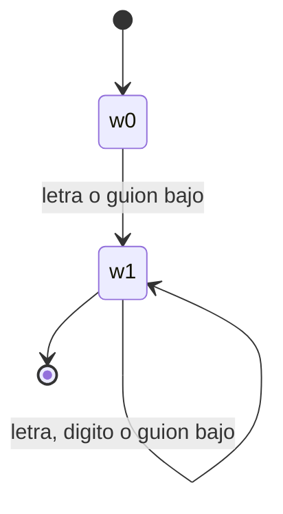
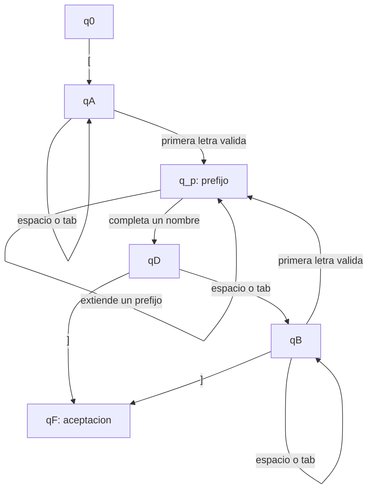
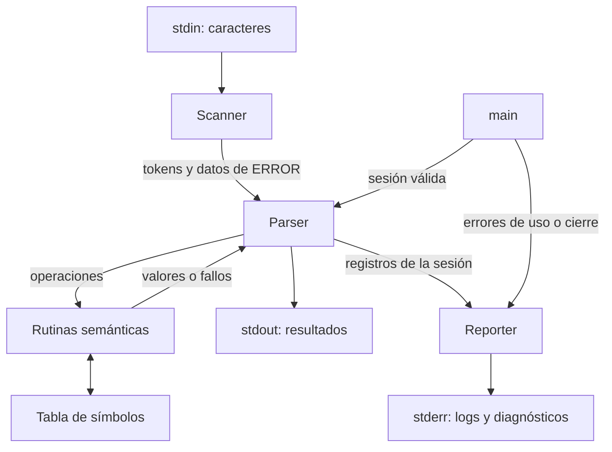
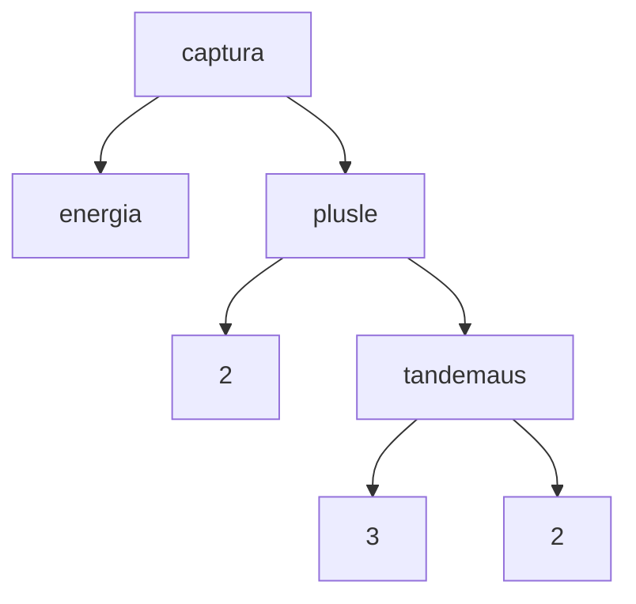

# PokéCalc - Especificación del lenguaje · Calculadora infija en C23

PokéCalc es una calculadora infija que representa los dígitos decimales con nombres de Pokémon. La idea es mantener un lenguaje sencillo para trabajar el léxico, la sintaxis y la semántica.

Este documento define las reglas que tiene que respetar la implementación manual en C23: representación de los números, tokens, gramática, operaciones, interfaces, errores y pruebas de aceptación. Los autómatas y el análisis LL(1) explican cómo se reconoce el lenguaje.

## Guía de lectura

| Qué necesitás | Por dónde empezar |
|---|---|
| Conocer el lenguaje | [Decisiones](#1-objetivo-y-decisiones-de-diseño) → [Números y nombres](#2-números-nombres-y-delimitadores) → [Ejemplo completo](#10-ejemplo-explicado-de-punta-a-punta). |
| Implementar el intérprete | [Léxico](#3-especificación-léxica-mediante-regex-de-estilo-flex) → [Autómatas](#4-autómatas-para-el-scanner-manual) → [Sintaxis](#5-especificación-sintáctica-mediante-bnf-de-estilo-bison) → [Semántica](#6-especificación-semántica-en-lenguaje-natural) → [Arquitectura](#9-arquitectura-e-interfaces-para-la-implementación-manual). |
| Revisar el comportamiento | [Diagnósticos](#7-diagnósticos-y-recuperación) → [Ejecución](#8-ejecución-interpretada-resultados-y-logs) → [Pruebas](#11-casos-de-aceptación). |

Si querés tener una primera idea, leé el inicio rápido y el ejemplo completo. Para revisar el diseño formal, seguí el recorrido del intérprete.

El índice enlaza las reglas y las pruebas del lenguaje. La organización de la entrega, las hipótesis sobre la consigna y las tareas pendientes están en [readme.md](readme.md).

## Inicio rápido

```text
captura energia = [ivysaur] plusle [venusaur] tandemaus [ivysaur];
energia;           # muestra 8
ditto(energia);    # muestra 16
liberar energia;
```

Para entender qué hace cada línea, podés consultar [operaciones](#62-expresiones-y-operaciones), [variables](#63-tabla-de-símbolos-captura-y-declaración) y [liberación](#64-liberación).

## Índice

- [Guía de lectura](#guía-de-lectura)
- [Inicio rápido](#inicio-rápido)
- [1. Objetivo y decisiones de diseño](#1-objetivo-y-decisiones-de-diseño)
- [2. Números, nombres y delimitadores](#2-números-nombres-y-delimitadores)
  - [2.1. Dígitos Pokémon](#21-dígitos-pokémon)
  - [2.2. Identificadores y palabras reservadas](#22-identificadores-y-palabras-reservadas)
  - [2.3. Espacios, comentarios y sentencias](#23-espacios-comentarios-y-sentencias)
- [3. Especificación léxica mediante regex de estilo Flex](#3-especificación-léxica-mediante-regex-de-estilo-flex)
  - [3.1. Definiciones](#31-definiciones)
  - [3.2. Reglas de reconocimiento, en orden de prioridad](#32-reglas-de-reconocimiento-en-orden-de-prioridad)
  - [3.3. Token, lexema y atributos](#33-token-lexema-y-atributos)
- [4. Autómatas para el scanner manual](#4-autómatas-para-el-scanner-manual)
  - [4.1. AFD de palabras](#41-afd-de-palabras)
  - [4.2. AFD del literal Pokémon](#42-afd-del-literal-pokémon)
- [5. Especificación sintáctica mediante BNF de estilo Bison](#5-especificación-sintáctica-mediante-bnf-de-estilo-bison)
  - [5.1. Gramática completa](#51-gramática-completa)
  - [5.2. FIRST y FOLLOW](#52-first-y-follow)
  - [5.3. Precedencia y asociatividad](#53-precedencia-y-asociatividad)
- [6. Especificación semántica en lenguaje natural](#6-especificación-semántica-en-lenguaje-natural)
  - [6.1. Dominio, conversión y rango](#61-dominio-conversión-y-rango)
  - [6.2. Expresiones y operaciones](#62-expresiones-y-operaciones)
  - [6.3. Tabla de símbolos, captura y declaración](#63-tabla-de-símbolos-captura-y-declaración)
  - [6.4. Liberación](#64-liberación)
  - [6.5. Efectos y frontera entre sentencias](#65-efectos-y-frontera-entre-sentencias)
- [7. Diagnósticos y recuperación](#7-diagnósticos-y-recuperación)
  - [7.1. Responsabilidad de los diagnósticos](#71-responsabilidad-de-los-diagnósticos)
  - [7.2. Formato y codificación](#72-formato-y-codificación)
  - [7.3. Recuperación](#73-recuperación)
- [8. Ejecución interpretada, resultados y logs](#8-ejecución-interpretada-resultados-y-logs)
  - [8.1. Flujos y argumentos](#81-flujos-y-argumentos)
  - [8.2. Salida de resultados](#82-salida-de-resultados)
  - [8.3. Logs y traza](#83-logs-y-traza)
  - [8.4. Estado del proceso](#84-estado-del-proceso)
- [9. Arquitectura e interfaces para la implementación manual](#9-arquitectura-e-interfaces-para-la-implementación-manual)
  - [9.1. Contrato entre scanner y parser](#91-contrato-entre-scanner-y-parser)
  - [9.2. Correspondencia entre gramática y funciones](#92-correspondencia-entre-gramática-y-funciones)
  - [9.3. Contrato del módulo Reporter](#93-contrato-del-módulo-reporter)
- [10. Ejemplo explicado de punta a punta](#10-ejemplo-explicado-de-punta-a-punta)
- [11. Casos de aceptación](#11-casos-de-aceptación)
  - [11.1. Casos por grupo](#111-casos-por-grupo)
  - [11.2. Prueba de capacidad](#112-prueba-de-capacidad)
  - [11.3. Sesión completa con recuperación](#113-sesión-completa-con-recuperación)
  - [11.4. Argumentos y traza](#114-argumentos-y-traza)
  - [11.5. Pruebas de integración del programa C](#115-pruebas-de-integración-del-programa-c)

---

## 1. Objetivo y decisiones de diseño

PokéCalc evalúa expresiones aritméticas infijas. Cada dígito decimal se escribe con el nombre de un Pokémon. El lenguaje admite variables y respeta la precedencia habitual de las operaciones.

| Aspecto | Decisión |
|---|---|
| Numeración | Base diez, posicional; cada nombre representa un dígito. |
| Literales | Naturales, incluido cero, entre corchetes. |
| Valores | Enteros entre −999999 y 999999, inclusive. |
| Operaciones | `plusle`, `minun`, `tandemaus` y `falinks`. |
| Negación | `minun` como operador unario. |
| Función especial | `ditto(x)` devuelve 2 × x, incluso si x es negativo. |
| Asignación | Explícita: `captura nombre = expresion;`. |
| Declaración | Implícita en la primera asignación válida. |
| Eliminación | `liberar nombre;`. |
| Final de sentencia | Punto y coma obligatorio. |
| Final de sesión | Fin de archivo de `stdin`. |
| Mayúsculas | Se distinguen de las minúsculas. |
| Implementación | Scanner y parser manuales; evaluación guiada por el parser. |

Las expresiones regulares, la gramática, la semántica y los ejemplos siguen estas decisiones.

---

## 2. Números, nombres y delimitadores

### 2.1. Dígitos Pokémon

La descomposición de `[bulbasaur mew charizard]` muestra el valor de cada posición:

| Componente | `bulbasaur` | `mew` | `charizard` |
|---|---:|---:|---:|
| Dígito | 1 | 0 | 9 |
| Valor de la posición | 100 | 10 | 1 |
| Aporte al número | 1 × 100 = 100 | 0 × 10 = 0 | 9 × 1 = 9 |

**Resultado: 100 + 0 + 9 = 109.**

| Dígito | Nombre |
|---:|---|
| 0 | `mew` |
| 1 | `bulbasaur` |
| 2 | `ivysaur` |
| 3 | `venusaur` |
| 4 | `squirtle` |
| 5 | `wartortle` |
| 6 | `blastoise` |
| 7 | `charmander` |
| 8 | `charmeleon` |
| 9 | `charizard` |

Los nombres válidos son los de la tabla y se escriben en minúsculas. Prestá atención a `bulbasaur` y `venusaur`: esas son las formas que reconoce el lenguaje.

Un literal contiene al menos un dígito Pokémon. Sus nombres se separan con uno o más espacios o tabulaciones. Puede haber espacios o tabulaciones inmediatamente después de abrir el corchete y antes de cerrarlo.

| Literal | Valor |
|---|---:|
| `[mew]` | 0 |
| `[ivysaur]` | 2 |
| `[bulbasaur mew]` | 10 |
| `[ivysaur venusaur]` | 23 |
| `[bulbasaur mew charizard]` | 109 |
| `[mew bulbasaur]` | 1 |

Los ceros iniciales están permitidos. No se admiten saltos de línea ni comentarios dentro de un literal.

Un literal natural de valor superior a 999999 tiene forma léxica válida, pero falla por rango al evaluarlo. El signo negativo se expresa fuera del literal:

```text
minun [charmander];
minun ([ivysaur] plusle [venusaur]);
```

Los resultados son −7 y −5. La expresión `minun [mew]` da cero.

### 2.2. Identificadores y palabras reservadas

Un identificador comienza con una letra ASCII o guion bajo, y continúa con letras ASCII, dígitos arábigos o guiones bajos. Puede tener hasta 31 caracteres. Por ejemplo: `energia`, `Energia`, `_reserva` y `energia2`.

Se distingue entre mayúsculas y minúsculas: `energia` y `Energia` son variables distintas.

Los diez nombres de dígitos de la [sección 2.1](#21-dígitos-pokémon) son palabras reservadas, junto con estas siete: `plusle`, `minun`, `tandemaus`, `falinks`, `ditto`, `captura` y `liberar`. No pueden usarse como nombres de variable. La reserva se aplica al nombre completo. `mewtwo`, `squirtle2` y `plusle_total` son identificadores válidos: el scanner reconoce la palabra más larga y luego compara ese lexema completo con las palabras reservadas. No divide `mewtwo` en `mew` y `two`. Dentro de un literal, en cambio, `[mewtwo]` es inválido porque solo se admiten los diez nombres de dígitos.

Puede haber hasta 32 variables al mismo tiempo. Reasignar una variable no ocupa otro lugar; `liberar` deja su lugar disponible para otra.

### 2.3. Espacios, comentarios y sentencias

Fuera de los literales se ignoran espacios, tabulaciones y saltos de línea. Los comentarios empiezan con `#` y terminan antes del siguiente salto de línea o en `EOF`. Un punto y coma dentro de un comentario no termina una sentencia.

Los saltos de línea no terminan sentencias. Una sentencia puede ocupar varias líneas y una línea puede contener varias sentencias. El punto y coma (`;`) es obligatorio.

La numeración de líneas y columnas empieza en uno. Cada byte ordinario y cada tabulación incrementan la columna en uno. CRLF cuenta como un salto de línea; LF y CR aislados también. La sintaxis usa caracteres ASCII; el contenido de los comentarios se ignora byte a byte.

---

## 3. Especificación léxica mediante regex de estilo Flex

### 3.1. Definiciones

```lex
HSPACE      [ \t]
PDIGIT      (mew|bulbasaur|ivysaur|venusaur|squirtle|wartortle|blastoise|charmander|charmeleon|charizard)
PNUM        \[{HSPACE}*{PDIGIT}({HSPACE}+{PDIGIT})*{HSPACE}*\]
WORD        [A-Za-z_][A-Za-z0-9_]*
ID          [A-Za-z_][A-Za-z0-9_]{0,30}
LONG_ID     [A-Za-z_][A-Za-z0-9_]{31,}
WS          [ \t\r\n]+
COMMENT     \#[^\r\n]*
BAD_PNUM    \[[^\]\r\n;]*\]?
ARABIC      [0-9]+
```

Estas expresiones regulares describen qué tiene que reconocer el scanner. La implementación del capítulo 23 es manual: Flex se usa como referencia de notación.

### 3.2. Reglas de reconocimiento, en orden de prioridad

En cada posición se elige la coincidencia más larga. Si hay un empate, gana la regla que aparece primero en la tabla.

| Patrón | Token o acción |
|---|---|
| `{WS}` | Ignorar y actualizar la posición. |
| `{COMMENT}` | Ignorar y actualizar la posición. |
| "`plusle`" | `PLUSLE` |
| "`minun`" | `MINUN` |
| "`tandemaus`" | `TANDEMAUS` |
| "`falinks`" | `FALINKS` |
| "`ditto`" | `DITTO` |
| "`captura`" | `CAPTURA` |
| "`liberar`" | `LIBERAR` |
| `{PNUM}` | `NATURAL` |
| `{PDIGIT}` | `ERROR` con `E_MISSINGNO`: un dígito requiere corchetes. |
| `{LONG_ID}` | `ERROR` con `E_LIMIT`: identificador demasiado largo. |
| `{ID}` | `IDENTIFIER` |
| "=" | '=' |
| ";" | ';' |
| "(" | '(' |
| ")" | ')' |
| `{BAD_PNUM}` | `ERROR` con `E_MISSINGNO`: número Pokémon mal formado. |
| `{ARABIC}` | `ERROR` con `E_MISSINGNO`: representación numérica no admitida. |
| . | `ERROR` con `E_LEXICAL`: otro byte no reconocido. |
| Fin de archivo | `EOF` |

`WORD` se usa para describir el autómata de palabras; `ID` y `LONG_ID` separan sus dos casos de longitud. La prioridad de las palabras reservadas sobre `ID` resuelve coincidencias de igual longitud. Por longitud, `mewtwo`, `squirtle2` y `plusle_total` producen un único `IDENTIFIER`; los lexemas exactos `mew`, `squirtle` y `plusle` conservan sus reglas reservadas.

`PNUM` precede a `BAD_PNUM`. Así, `[ivysaur]` es válido y `[pikachu]` produce MissingNo. Si falta `]`, `BAD_PNUM` se detiene antes de `;`, CR, LF o `EOF`. Así conserva el delimitador que permite recuperarse del error.

El `EOF` de la tabla es un token lógico. En C se usará un nombre como `TOKEN_EOF`, evitando confundirlo con la constante `EOF` de `stdio.h`.

### 3.3. Token, lexema y atributos

El scanner entrega la clase del token, su posición inicial y los atributos necesarios. Si detecta un error léxico, devuelve `ERROR` con código, posición y detalle. El parser decide si corresponde informar el diagnóstico y se lo solicita a `Reporter`, según la [sección 7.1](#71-responsabilidad-de-los-diagnósticos).

| Lexema | Clase | Atributo |
|---|---|---|
| `[ivysaur]` | `NATURAL` | Valor 2; rango válido. |
| `[bulbasaur mew]` | `NATURAL` | Valor 10; rango válido. |
| `energia` | `IDENTIFIER` | Nombre `energia`. |
| `tandemaus` | `TANDEMAUS` | Sin valor numérico. |
| `[pikachu]` | `ERROR` | Código `E_MISSINGNO`, ubicación y detalle. |

`NATURAL` lleva el valor convertido y un indicador de rango. Para un literal bien formado superior a 999999 se conserva la clase `NATURAL` y se marca el atributo como fuera de rango. Al evaluar ese token, el parser solicita el diagnóstico semántico `E_RANGE`.

La conversión puede detener la acumulación numérica al superar el límite y continuar consumiendo el literal, para evitar desbordamientos. Este control no transforma un número bien escrito en un error de reconocimiento.

Si un lexema no entra en el búfer del diagnóstico, puede mostrarse abreviado, siempre que se indique el recorte. El scanner tiene que seguir consumiendo el token completo y conservar su posición inicial.

---

## 4. Autómatas para el scanner manual

### 4.1. AFD de palabras

L representa las letras ASCII y el guion bajo (`_`); D representa los dígitos arábigos. El AFD reconoce `WORD`.

| Estado | L | D | Otro byte |
|---|---|---|---|
| w0, inicial | w1 | w⊥ | w⊥ |
| w1, aceptación | w1 | w1 | w⊥ |
| w⊥, rechazo | w⊥ | w⊥ | w⊥ |



*Diagrama 1. AFD de palabras: inicio, aceptación y rechazo.*

Al terminar la palabra, se consulta la tabla de palabras reservadas y se verifica su longitud. El scanner mantiene el byte que terminó la palabra como anticipación para el próximo token; ese byte no forma parte del lexema.

### 4.2. AFD del literal Pokémon

El AFD se describe mediante una familia finita de estados. De esta manera se pueden precisar las transiciones por carácter sin dibujar por separado todas las letras de los diez nombres:

- V: conjunto de los diez nombres de la [sección 2.1](#21-dígitos-pokémon).
- P: conjunto de todos los prefijos propios no vacíos de los nombres de V.
- q0: inicial.
- qA: se leyó `[` y se admiten espacios o tabulaciones iniciales.
- q_p, para cada p de P: se leyó el prefijo p de un nombre.
- qD: se completó un nombre válido.
- qB: se completó un nombre y se leyó al menos un blanco.
- qF: se leyó `]`; único estado de aceptación.
- q⊥: rechazo.

El alfabeto es el de bytes de entrada; H representa espacio o tabulación. Ningún nombre de V es prefijo propio de otro.

| Estado | Entrada | Destino |
|---|---|---|
| q0 | `[` | qA |
| qA | h de H | qA |
| qA o qB | letra c tal que c pertenece a P | q_c |
| q_p | letra c tal que pc pertenece a P | q_pc |
| q_p | letra c tal que pc pertenece a V | qD |
| qD | h de H | qB |
| qD | `]` | qF |
| qB | h de H | qB |
| qB | `]` | qF |
| Cualquier estado | Cualquier caso no definido arriba | q⊥ |
| q⊥ | Cualquier byte | q⊥ |

Desde qF cualquier byte adicional lleva a rechazo. En la tokenización, al llegar a `]` se termina ese literal y el siguiente byte queda para el próximo token.

El siguiente diagrama resume la familia de estados q_p con el nodo Prefijo. La tabla anterior define las transiciones exactas por carácter.



*Diagrama 2. AFD resumido del numeral; q_p representa la familia de prefijos.*

Ejemplo: `[ivysaur mew]` recorre q0, qA, los prefijos i, iv, ivy, ivys, ivysa e ivysau, qD, qB, los prefijos m y me, qD y qF.

Si este reconocimiento falla, la regla `BAD_PNUM` obtiene el candidato inválido para informar MissingNo. El AFD reconoce la escritura del número; el valor decimal se obtiene mediante sus atributos.

---

## 5. Especificación sintáctica mediante BNF de estilo Bison

### 5.1. Gramática completa

El axioma es `translation-unit`. `%empty` representa la cadena vacía. Los símbolos en mayúsculas y los caracteres entre comillas simples son terminales. `EOF` es la anticipación de fin de entrada y no se escribe en el programa.

```bison
translation-unit
    : statement-list
    ;

statement-list
    : %empty
    | statement statement-list
    ;

statement
    : CAPTURA IDENTIFIER '=' expression ';'
    | LIBERAR IDENTIFIER ';'
    | expression ';'
    ;

expression
    : term expression-tail
    ;

expression-tail
    : %empty
    | PLUSLE term expression-tail
    | MINUN term expression-tail
    ;

term
    : unary term-tail
    ;

term-tail
    : %empty
    | TANDEMAUS unary term-tail
    | FALINKS unary term-tail
    ;

unary
    : MINUN unary
    | primary
    ;

primary
    : NATURAL
    | IDENTIFIER
    | '(' expression ')'
    | DITTO '(' expression ')'
    ;
```

Se acepta la entrada cuando se reconoce `translation-unit` y la anticipación es `EOF`. El programa vacío es válido. No se admiten sentencias vacías, asignaciones encadenadas, asignaciones dentro de expresiones ni llamadas sin argumento.

La gramática no tiene recursión izquierda. Las tres alternativas de `statement` empiezan con `CAPTURA`, `LIBERAR` o un símbolo que inicia `expression`, respectivamente. Estos conjuntos son disjuntos y permiten un solo token de anticipación.

### 5.2. FIRST y FOLLOW

En esta tabla, ε representa la cadena vacía. Se usan estas abreviaturas:

- E = {`NATURAL`, `IDENTIFIER`, `MINUN`, '(', `DITTO`}.
- S = E ∪ {`CAPTURA`, `LIBERAR`}.
- A = {`PLUSLE`, `MINUN`}.
- M = {`TANDEMAUS`, `FALINKS`}.
- C = {';', ')'}.

| No terminal | FIRST | FOLLOW |
|---|---|---|
| `translation-unit` | S ∪ {ε} | {`EOF`} |
| `statement-list` | S ∪ {ε} | {`EOF`} |
| `statement` | S | S ∪ {`EOF`} |
| `expression` | E | C |
| `expression-tail` | A ∪ {ε} | C |
| `term` | E | A ∪ C |
| `term-tail` | M ∪ {ε} | A ∪ C |
| `unary` | E | M ∪ A ∪ C |
| `primary` | E − {`MINUN`} | M ∪ A ∪ C |

Para cada no terminal, las alternativas tienen conjuntos de selección disjuntos. Las alternativas vacías solo se seleccionan cuando la anticipación está en FOLLOW del no terminal. Esta verificación justifica el análisis LL(1).

### 5.3. Precedencia y asociatividad

| Prioridad, de mayor a menor | Construcciones | Evaluación |
|---:|---|---|
| 1 | Literales, variables, agrupación y `ditto(...)` | Cada agrupación o argumento se evalúa antes de usarse. |
| 2 | `minun` unario | Se aplica a la expresión unaria que sigue. |
| 3 | `tandemaus`, `falinks` | De izquierda a derecha. |
| 4 | `plusle`, `minun` binario | De izquierda a derecha. |

Aunque las colas de la gramática son recursivas a la derecha, sus acciones semánticas deben acumular el resultado de izquierda a derecha.

Por ejemplo, 9 − 3 − 2 da 4, y 8 / 2 / 2 da 2. La negación permite escribir `minun minun [ivysaur]` y `[wartortle] minun minun [ivysaur]`.

---

## 6. Especificación semántica en lenguaje natural

### 6.1. Dominio, conversión y rango

El dominio de valores es el conjunto de enteros del intervalo [−999999, 999999]. El de los literales naturales es [0, 999999].

La conversión empieza con un acumulador en cero. Por cada nombre de dígito d, en su orden de aparición, el acumulador pasa a valer 10 × acumulador + valor(d). Los ceros iniciales no cambian el valor.

Las operaciones se calculan internamente con `int64_t`. Dos operandos válidos tienen producto absoluto máximo 999998000001, representable en ese tipo. Después de cada operación se comprueba el rango de PokéCalc. El control se aplica a cada resultado intermedio de la expresión.

Un literal o resultado intermedio fuera del dominio produce `E_RANGE` y rechaza la sentencia. La conversión de literales largos comprueba el límite a medida que avanza, sin desbordar el acumulador de C.

### 6.2. Expresiones y operaciones

Los operandos se evalúan de izquierda a derecha, respetando la estructura que define la gramática.

| Construcción | Regla semántica |
|---|---|
| `NATURAL` | Usar su atributo numérico si está dentro del dominio; en caso contrario, `E_RANGE`. |
| `IDENTIFIER` | Consultar su valor en la tabla de símbolos; si no existe, `E_UNDEFINED`. |
| `a plusle b` | Evaluar ambos operandos y devolver a + b, comprobando el rango. |
| `a minun b` | Evaluar ambos operandos y devolver a − b, comprobando el rango. |
| `a tandemaus b` | Evaluar ambos operandos y devolver a × b, comprobando el rango. |
| `a falinks b` | Evaluar ambos operandos; si b es cero, `E_DIV_ZERO`; en otro caso, devolver a / b truncado hacia cero. |
| `minun a` | Evaluar a y devolver su opuesto, comprobando el rango. |
| `(a)` | Devolver el valor de a. |
| `ditto(a)` | Evaluar a una sola vez y devolver 2 × a, comprobando el rango. |

Ejemplos de división: 7 / 2 produce 3; −7 / 2 produce −3; 7 / −2 produce −3; −7 / −2 produce 3.

`ditto` acepta cero y negativos. Por ejemplo, al duplicar 23 se obtiene 46; al duplicar −2, se obtiene −4; y al duplicar 0, se obtiene 0. En el código fuente esos argumentos se escriben con la representación Pokémon correspondiente.

Toda sentencia de expresión correcta imprime su resultado. Una sentencia fallida no imprime un valor.

### 6.3. Tabla de símbolos, captura y declaración

La tabla de símbolos se inicializa vacía. Cada entrada asocia un identificador con un valor del dominio.

**La asignación es explícita:** se escribe `captura nombre = expresion;`. **La declaración es implícita:** la primera asignación válida crea la variable, sin un paso previo de declaración. La misma instrucción `captura` sirve para crearla o actualizarla.

Para ejecutar una `captura`:

1. Reconocer `CAPTURA`, el identificador y el signo igual.
2. Evaluar la expresión usando la tabla actual. El nombre de la izquierda no se consulta; los de la derecha sí.
3. Verificar el punto y coma final.
4. Si el nombre existe, reemplazar su valor. Si no existe y hay un lugar disponible, crear la entrada. Si la tabla está llena y el nombre es nuevo, informar `E_LIMIT`.
5. Devolver el resultado al parser, que solicita a `Reporter` el registro de éxito en `stderr`.

La actualización se aplica una sola vez al completar la sentencia. Si hay un error, se conserva la tabla anterior. Por ejemplo, `captura energia = energia plusle [bulbasaur];` falla si `energia` no existía; si ya existía, le suma uno.

El alcance de los nombres es global a la sesión. Cada variable existe desde la primera `captura` válida hasta que se la libera o termina la sesión. No hay bloques con alcances locales.

### 6.4. Liberación

Para ejecutar `liberar nombre;`:

1. Reconocer `LIBERAR`, un identificador y el punto y coma.
2. Verificar que la variable exista; en caso contrario, `E_UNDEFINED`.
3. Eliminar la entrada y dejar su lugar disponible.
4. Devolver el resultado al parser, que solicita a `Reporter` el registro de éxito en `stderr`.

Si la sentencia está mal formada, no se modifica la tabla. La variable liberada puede volver a crearse mediante `captura`. Leerla o liberarla otra vez antes de volver a crearla produce `E_UNDEFINED`.

Las capturas y liberaciones correctas no escriben resultados en `stdout`.

### 6.5. Efectos y frontera entre sentencias

El reconocimiento del punto y coma completa la sentencia actual. Sus efectos y su resultado se confirman antes de tratar errores de la sentencia siguiente.

Por ejemplo, en `captura energia = [ivysaur]; @;`, la primera `captura` queda confirmada aunque el byte siguiente sea inválido.

Las expresiones no modifican la tabla. Si una evaluación falla, se cancela la sentencia completa; no se reemplaza el error por cero ni por un Pokémon válido.

---

## 7. Diagnósticos y recuperación

MissingNo es la etiqueta temática para una representación numérica inválida. Su código es `E_MISSINGNO` y no forma parte del dominio de números.

| Categoría | Código | Causa |
|---|---|---|
| Léxico | `E_MISSINGNO` | Pokémon desconocido dentro de un número, corchetes faltantes o vacíos, dígitos sin separación, dígito reservado sin corchetes o números arábigos. |
| Léxico | `E_LEXICAL` | Otro byte no admitido. |
| Léxico o capacidad | `E_LIMIT` | Identificador de más de 31 caracteres. |
| Sintáctico | `E_SYNTAX` | La secuencia de tokens no puede derivarse de la gramática. |
| Semántico | `E_UNDEFINED` | Lectura o liberación de una variable inexistente. |
| Semántico | `E_DIV_ZERO` | Divisor con valor cero. |
| Semántico | `E_RANGE` | Literal o resultado intermedio fuera de [−999999, 999999]. |
| Semántico o capacidad | `E_LIMIT` | Captura de un nombre nuevo cuando ya existen 32 variables. |
| Ejecución, fatal | `E_IO` | Fallo de lectura o escritura. |
| Ejecución, fatal | `E_RESOURCE` | Recursos de ejecución insuficientes. |
| Uso, fatal | `E_USAGE` | Argumentos del ejecutable no admitidos. |

### 7.1. Responsabilidad de los diagnósticos

- **Scanner:** devuelve tokens `ERROR` con sus datos. No escribe en `stdout` ni en `stderr`.
- **Rutinas semánticas:** devuelven valores o fallos con los datos necesarios para ubicarlos. No escriben en los flujos de salida.
- **Parser:** detecta los errores sintácticos, decide cuándo informar los errores de la sesión y coordina la recuperación. Solicita los registros `ERROR`, `INFO` y `TRACE` a `Reporter`. También escribe los resultados de las expresiones en `stdout`.
- **main:** valida los argumentos antes de iniciar el parser y controla el cierre. Solicita a `Reporter` los registros de `E_USAGE` y de los errores fatales que ocurran fuera de la ejecución del parser. Evita volver a informar un error ya comunicado por el parser.
- **Reporter:** define los datos comunes de los diagnósticos y centraliza el formato y la escritura de `ERROR`, `INFO` y `TRACE` en `stderr`. Aplica la codificación ASCII de la sección siguiente. La detección de errores y la recuperación permanecen en las etapas anteriores.

Durante la ejecución del parser, un fallo fatal se informa una sola vez mediante `Reporter` y termina la sesión con estado 2, que el parser devuelve a `main`. Esta distribución evita mensajes duplicados.

### 7.2. Formato y codificación

Cada diagnóstico incluye el nivel `ERROR`, el código, la línea, la columna y una causa concreta. Los errores que no están asociados a una posición del código fuente, como `E_USAGE`, pueden omitir la ubicación. No se inventa un valor para continuar una operación inválida.

`Reporter.c` formatea y escribe todos los registros de `stderr` (`INFO`, `ERROR` y `TRACE`) en ASCII. Cada registro ocupa una línea y termina con LF. Las claves y los valores de acción se escriben sin tildes: `linea`, `columna`, `asignacion`, `evaluacion` y `liberacion`.

Si el mensaje incluye texto de la entrada, los bytes fuera del ASCII imprimible se representan como `\xHH`, con dos dígitos hexadecimales en mayúsculas. Se usan `\n`, `\r` y `\t` para esos controles, y `\\` y `\"` para la barra inversa y las comillas dentro de un campo entre comillas. Nunca se copia un byte no ASCII directamente a un registro. Por ejemplo, la `é` de una entrada UTF-8 se muestra como `\xC3\xA9`.

El texto de `mensaje` explica la causa y puede variar. Las pruebas de errores comparan código y ubicación; la codificación ASCII y la presencia de una causa también son obligatorias. Los ejemplos de traza y de uso que se fijan en la [sección 11.4](#114-argumentos-y-traza) sí tienen una salida exacta.

La ubicación de un número inválido es su comienzo; la de una variable inexistente es su identificador; la de un fallo aritmético es el operador o la llamada `ditto`; la de un error sintáctico es el token inesperado o `EOF`.

```text
ERROR linea=1 columna=1 codigo=E_MISSINGNO mensaje="MissingNo: pikachu no representa un digito decimal"
```

### 7.3. Recuperación

Después de un error recuperable, se descarta la parte pendiente de la sentencia hasta el próximo `;` o `EOF`. Si se encuentra `;`, se consume únicamente ese delimitador y se reinicia el análisis de la siguiente sentencia. Durante el descarte, el scanner sigue devolviendo tokens, incluidos los `ERROR`. El parser no solicita otro registro `ERROR` por esos tokens. Si está activo `--trace`, sí solicita sus registros `TRACE` a `Reporter`: una traza describe el recorrido y no cuenta como otro diagnóstico.

Se informa un solo error principal por sentencia rechazada. Si contiene varias causas, se admite el primer error detectado por el análisis; los casos de aceptación independientes evitan depender de una prioridad global entre causas distintas.

Si falta el punto y coma, la recuperación puede descartar también texto de la línea siguiente hasta encontrarlo. El salto de línea no alcanza para retomar el análisis.

Los errores fatales terminan la ejecución. Los errores recuperables permiten llegar al fin de archivo conservando las variables creadas por otras sentencias correctas.

---

## 8. Ejecución interpretada, resultados y logs

### 8.1. Flujos y argumentos

El programa escrito en C se compila para obtener el ejecutable `pokecalc`. Ese ejecutable funciona como intérprete: lee y evalúa las sentencias de PokéCalc durante la ejecución. El parser llama al scanner y a las rutinas semánticas, sin generar código C para cada expresión.

| Flujo | Uso |
|---|---|
| `stdin` | Entrada del programa Pokémon. |
| `stdout` | Una línea por expresión correcta. |
| `stderr` | Registros `INFO`, diagnósticos `ERROR` y trazas opcionales. |

El ejecutable se puede usar sin argumentos o con `--trace`. Otra combinación genera `E_USAGE` y termina con estado 2. Los argumentos se validan antes de leer `stdin`; ante un uso inválido no se emiten registros `INFO` ni `TRACE`. La interfaz básica no imprime mensajes de bienvenida ni indicadores de entrada. Después de cada resultado, se ejecuta `fflush` sobre `stdout` para que la salida se vea de inmediato en una sesión interactiva.

Para probarlo desde una terminal, podés usar estas formas:

```bash
./pokecalc
./pokecalc < expresiones.txt
./pokecalc < expresiones.txt > resultados.txt 2> ejecucion.log
./pokecalc --trace < expresiones.txt
```

### 8.2. Salida de resultados

Cada valor se imprime con su representación Pokémon canónica y su valor decimal entre paréntesis. Se usa exactamente un espacio entre dígitos y no se imprimen ceros iniciales.

```text
[charmeleon] (8)
[bulbasaur blastoise] (16)
minun [bulbasaur] (-1)
[mew] (0)
```

El signo de un resultado negativo se escribe como `minun` delante del literal de su magnitud. El cero siempre se imprime como `[mew] (0)`. El rango simétrico permite representar como literal la magnitud de cualquier resultado negativo.

La anotación decimal de la salida facilita la comprobación; no forma parte de la sintaxis del programa de entrada.

### 8.3. Logs y traza

El parser solicita a `Reporter` un registro `INFO` por cada sentencia correcta, con su ubicación inicial y acción. Las asignaciones incluyen nombre y valor; las liberaciones, nombre; las evaluaciones, valor. Los errores siguen el formato de la [sección 7](#7-diagnósticos-y-recuperación). Los registros se escriben en `stderr`.

```text
INFO linea=1 columna=1 accion=asignacion variable=energia valor=8
INFO linea=2 columna=1 accion=evaluacion valor=8
INFO linea=3 columna=1 accion=liberacion variable=energia
```

Con `--trace`, el parser llama a `ReporterTrace` apenas recibe cada token de `GetNextToken`, incluso durante el descarte. La forma es `TRACE linea=L columna=C token=CLASE`, seguida por los atributos de esta tabla, en el orden indicado. La clase de un signo se escribe entre comillas simples: `'='`, `';'`, `'('` o `')'`.

| Clase | Atributos después de `token` |
|---|---|
| `NATURAL` dentro del rango | `valor=N` |
| `NATURAL` fuera del rango | `fuera_de_rango=1`; no se imprime un valor desbordado. |
| `IDENTIFIER` | `nombre=identificador` |
| `ERROR` | `codigo=E_...` |
| Otras clases, incluido `EOF` | Ninguno. |

El parser solicita un solo token de anticipación por vez. Confirma la sentencia y solicita su `INFO` a `Reporter` antes de pedir el token siguiente al punto y coma. Al recibir el primer `EOF`, termina sin pedir más tokens. Por eso hay una sola traza de `EOF` por sesión.

Para la entrada `[ivysaur] tandemaus [venusaur];`, la secuencia de clases y atributos es:

```text
NATURAL(2) TANDEMAUS NATURAL(3) ';' EOF
```

### 8.4. Estado del proceso

| Estado | Significado |
|---:|---|
| 0 | Se alcanzó `EOF` sin errores. |
| 1 | Se alcanzó `EOF` con alguna sentencia rechazada. |
| 2 | Terminación por error fatal o uso incorrecto del ejecutable. |

---

## 9. Arquitectura e interfaces para la implementación manual

La solución tiene que incluir al menos `main`, `Scanner` y `Parser`, como pide la sección 23.5 de la consigna. Se agregan `Semantics` para las reglas de cálculo y la tabla de símbolos, y `Reporter` para el formato y la escritura de logs y diagnósticos.



*Diagrama 3. Flujo de datos e interfaces del intérprete.*

| Archivo | Responsabilidad |
|---|---|
| `main.c` | Argumentos, inicialización, llamada al parser, cierre y estado de salida; solicita a `Reporter` los errores de uso o cierre. |
| `Scanner.h` | Tipos y contrato de los tokens; `GetNextToken`. |
| `Scanner.c` | Reconocimiento manual por caracteres y posiciones; devuelve datos de error sin imprimirlos. |
| `Parser.h` | Interfaz pública del análisis. |
| `Parser.c` | Descenso recursivo, recuperación, acciones semánticas y resultados; decide qué registros solicita a `Reporter`. |
| `Semantics.h` | Interfaz de las operaciones, variables y resultados. |
| `Semantics.c` | Aritmética, conversión y tabla de 32 variables; devuelve valores o fallos sin imprimirlos. |
| `Reporter.h` | Tipos comunes de códigos, gravedad, posición y datos de los registros; interfaz de reporte. |
| `Reporter.c` | Formato ASCII y escritura de `ERROR`, `INFO` y `TRACE` en `stderr`. |

### 9.1. Contrato entre scanner y parser

La operación de comunicación se llama `GetNextToken`. El scanner obtiene exclusivamente los bytes de `stdin` mediante `getchar` y conserva en un `int` el valor recibido, para distinguir cualquier byte de `EOF`.

`GetNextToken` omite blancos y comentarios y devuelve un solo token lógico. Puede conservar el byte de anticipación que pertenece al siguiente token. No consume `;` ni el salto de línea al obtener un `BAD_PNUM` sin cierre que termina antes de ellos.

El parser mantiene un token de anticipación. No llama a `getchar` ni interpreta caracteres directamente. El scanner no reconoce producciones ni modifica variables.

La detección de un token `ERROR` se comunica al parser con su código, posición y detalle. Si el error es léxico y recuperable, en análisis normal cancela la sentencia e inicia la recuperación; durante el descarte, el parser lo consume sin volver a informar un error. Un fallo de lectura o de recursos se comunica como `ERROR` con `E_IO` o `E_RESOURCE`: el parser solicita el diagnóstico a `Reporter` y termina con estado 2, incluso si estaba descartando tokens. El scanner no imprime mensajes en ninguno de estos casos. `EOF` se devuelve de forma estable una vez alcanzado.

### 9.2. Correspondencia entre gramática y funciones

Debe existir una función por cada no terminal, con esta correspondencia:

| No terminal | Función de análisis |
|---|---|
| `translation-unit` | `ParseTranslationUnit` |
| `statement-list` | `ParseStatementList` |
| `statement` | `ParseStatement` |
| `expression` | `ParseExpression` |
| `expression-tail` | `ParseExpressionTail` |
| `term` | `ParseTerm` |
| `term-tail` | `ParseTermTail` |
| `unary` | `ParseUnary` |
| `primary` | `ParsePrimary` |

`ParseExpressionTail` y `ParseTermTail` reciben o conservan el acumulador que permite asociar a la izquierda. Sus funciones pueden usar bucles para las repeticiones, manteniendo la correspondencia con los no terminales.

Las rutinas semánticas calculan los valores solicitados por el parser, consultan la tabla y aplican los efectos al completar una sentencia. La implementación tiene que seguir estas reglas. Si después cambia una decisión de diseño, primero hay que actualizar la especificación y los casos correspondientes.

### 9.3. Contrato del módulo Reporter

`Reporter` concentra la presentación de los diagnósticos y los logs. Su interfaz recibe datos explícitos del llamador:

| Operación pública | Datos que recibe | Registro que escribe |
|---|---|---|
| `ReporterError` | Código, gravedad, detalle y ubicación cuando corresponda. | `ERROR`, con el formato de la sección 7. |
| `ReporterInfo` | Posición inicial, acción, nombre y valor cuando correspondan. | `INFO`, con el formato de la sección 8.3. |
| `ReporterTrace` | Nombre de la clase del token, posición y atributos aplicables. | `TRACE`, con el formato de la sección 8.3. |

`Reporter.h` define los tipos compartidos que necesitan el scanner, el parser, las rutinas semánticas y `main` para intercambiar códigos, gravedad, ubicaciones y detalles. `Scanner.h` y `Semantics.h` pueden incluir ese encabezado para devolver errores con la misma representación.

El scanner y las rutinas semánticas devuelven esos datos al parser. El parser y `main` llaman a las operaciones de reporte cuando corresponde. `Reporter.h` no depende de `Scanner.h`, `Parser.h` ni `Semantics.h`: recibe datos simples y no necesita conocer sus estructuras internas. Esto mantiene las dependencias sin ciclos.

La recuperación, la cancelación de una sentencia y la elección del estado de salida siguen a cargo del parser y de `main`. La impresión de los valores Pokémon en `stdout` sigue a cargo del parser. `Reporter.c` es el único módulo que formatea y escribe los registros de `stderr`.

Las operaciones de reporte informan al llamador si pudieron escribir el registro. Si falla la escritura en `stderr`, el llamador termina con estado 2 sin intentar emitir otro registro en ese mismo flujo.

---

## 10. Ejemplo explicado de punta a punta

Fuente:

```text
captura energia = [ivysaur] plusle [venusaur] tandemaus [ivysaur];
```

Tokens:

```text
CAPTURA IDENTIFIER(energia) '=' NATURAL(2) PLUSLE NATURAL(3) TANDEMAUS NATURAL(2) ';' EOF
```

El análisis sintáctico reconoce una sentencia de la forma `CAPTURA IDENTIFIER '=' expression ';'`. Dentro de `expression`, el primer `term` vale 2; la cola `PLUSLE` consume un segundo `term` que agrupa 3 `tandemaus` 2.

Árbol abstracto que resume esa estructura:



*Diagrama 4. La multiplicación se evalúa antes que la suma.*

Este árbol se usa para la explicación; la implementación puede evaluar directamente durante el descenso recursivo.

Las rutinas semánticas calculan 3 × 2 = 6 y luego 2 + 6 = 8. Al reconocer `;`, se crea la entrada `energia → 8`. El parser solicita a `Reporter` el `INFO` de la `captura` y no imprime una expresión en `stdout`.

Si después escribís `energia;`, se imprime `[charmeleon] (8)`. La sentencia `liberar energia;` elimina la entrada. Consultar `energia` a partir de ese momento genera `E_UNDEFINED`.

---

## 11. Casos de aceptación

Cada fila representa una sesión independiente, con la tabla de símbolos vacía al comenzar. La columna de resultados muestra valores decimales para que sea más fácil comprobarlos; en `stdout` se usa el formato de la [sección 8.2](#82-salida-de-resultados).

Para leer las tablas, tené en cuenta estas referencias:

- **—**: no se imprimen valores o no hay diagnósticos, según la columna.
- **∅**: entrada vacía.
- `\n`, `\r` y `\t`: caracteres LF, CR y tabulación, respectivamente.

Los 84 casos tabulares están agrupados por tema. A continuación se agregan dos sesiones de capacidad y cinco casos de línea de comandos. Podés usar estos enlaces para ir al grupo que quieras revisar:

### 11.1. Casos por grupo

- [T01–T06 · Entrada y literales (6 casos)](#t01t06--entrada-y-literales-6-casos)
- [T07–T19 · Operadores, precedencia y negativos (13 casos)](#t07t19--operadores-precedencia-y-negativos-13-casos)
- [T20–T22 · Función ditto (3 casos)](#t20t22--función-ditto-3-casos)
- [T23–T32 · Captura, variables y liberación (10 casos)](#t23t32--captura-variables-y-liberación-10-casos)
- [T33–T43 · Diagnósticos básicos (11 casos)](#t33t43--diagnósticos-básicos-11-casos)
- [T44–T51 · Errores de sintaxis (8 casos)](#t44t51--errores-de-sintaxis-8-casos)
- [T52–T57 · Recuperación y conservación de variables (6 casos)](#t52t57--recuperación-y-conservación-de-variables-6-casos)
- [T58–T66 · Rango numérico (9 casos)](#t58t66--rango-numérico-9-casos)
- [T67–T70 · Longitud de nombres y finales de línea (4 casos)](#t67t70--longitud-de-nombres-y-finales-de-línea-4-casos)
- [T71–T84 · Límites léxicos, función ditto y precedencia (14 casos)](#t71t84--límites-léxicos-función-ditto-y-precedencia-14-casos)

#### T01–T06 · Entrada y literales (6 casos)

| Caso | Entrada | Valores en stdout | Diagnósticos | Estado |
|---|---|---|---|---:|
| T01 | `∅` | — | — | 0 |
| T02 | `# comentario con ;\n` | — | — | 0 |
| T03 | `[mew];` | 0 | — | 0 |
| T04 | `[bulbasaur mew];` | 10 | — | 0 |
| T05 | `[mew bulbasaur];` | 1 | — | 0 |
| T06 | `[ \tivysaur\tvenusaur ];` | 23 | — | 0 |

#### T07–T19 · Operadores, precedencia y negativos (13 casos)

| Caso | Entrada | Valores en stdout | Diagnósticos | Estado |
|---|---|---|---|---:|
| T07 | `[ivysaur] plusle [venusaur];` | 5 | — | 0 |
| T08 | `[bulbasaur] plusle [ivysaur] tandemaus [venusaur];` | 7 | — | 0 |
| T09 | `([bulbasaur] plusle [ivysaur]) tandemaus [venusaur];` | 9 | — | 0 |
| T10 | `[charizard] minun [venusaur] minun [ivysaur];` | 4 | — | 0 |
| T11 | `[charmeleon] falinks [ivysaur] falinks [ivysaur];` | 2 | — | 0 |
| T12 | `minun [charmander];` | -7 | — | 0 |
| T13 | `minun minun [charmander];` | 7 | — | 0 |
| T14 | `minun [mew];` | 0 | — | 0 |
| T15 | `[wartortle] minun minun [ivysaur];` | 7 | — | 0 |
| T16 | `[charmander] falinks [ivysaur];` | 3 | — | 0 |
| T17 | `minun [charmander] falinks [ivysaur];` | -3 | — | 0 |
| T18 | `[charmander] falinks minun [ivysaur];` | -3 | — | 0 |
| T19 | `minun [charmander] falinks minun [ivysaur];` | 3 | — | 0 |

#### T20–T22 · Función ditto (3 casos)

| Caso | Entrada | Valores en stdout | Diagnósticos | Estado |
|---|---|---|---|---:|
| T20 | `ditto([ivysaur venusaur]);` | 46 | — | 0 |
| T21 | `ditto(minun [ivysaur]);` | -4 | — | 0 |
| T22 | `ditto([mew]);` | 0 | — | 0 |

#### T23–T32 · Captura, variables y liberación (10 casos)

| Caso | Entrada | Valores en stdout | Diagnósticos | Estado |
|---|---|---|---|---:|
| T23 | `captura energia = [ivysaur]; energia plusle [venusaur];` | 5 | — | 0 |
| T24 | `captura energia = [ivysaur]; captura energia = energia tandemaus [venusaur]; energia;` | 6 | — | 0 |
| T25 | `captura energia = [ivysaur]; liberar energia;` | — | — | 0 |
| T26 | `captura energia = [ivysaur]; liberar energia; energia;` | — | `E_UNDEFINED` | 1 |
| T27 | `liberar energia;` | — | `E_UNDEFINED` | 1 |
| T28 | `captura energia = [ivysaur]; liberar energia; liberar energia;` | — | `E_UNDEFINED` | 1 |
| T29 | `captura energia = [ivysaur]; liberar energia; captura energia = [venusaur]; energia;` | 3 | — | 0 |
| T30 | `energia;` | — | `E_UNDEFINED` | 1 |
| T31 | `captura energia = energia plusle [bulbasaur];` | — | `E_UNDEFINED` | 1 |
| T32 | `captura energia = [ivysaur]; Energia;` | — | `E_UNDEFINED` | 1 |

#### T33–T43 · Diagnósticos básicos (11 casos)

| Caso | Entrada | Valores en stdout | Diagnósticos | Estado |
|---|---|---|---|---:|
| T33 | `[bulbasaur] falinks [mew];` | — | `E_DIV_ZERO` | 1 |
| T34 | `[ivysaur] falinks ([bulbasaur] minun [bulbasaur]);` | — | `E_DIV_ZERO` | 1 |
| T35 | `[pikachu];` | — | `E_MISSINGNO` | 1 |
| T36 | `[bulbasaurmew];` | — | `E_MISSINGNO` | 1 |
| T37 | `bulbasaur;` | — | `E_MISSINGNO` | 1 |
| T38 | `12;` | — | `E_MISSINGNO` | 1 |
| T39 | `[];` | — | `E_MISSINGNO` | 1 |
| T40 | `[ivysaur;` | — | `E_MISSINGNO` | 1 |
| T41 | `[missingno];` | — | `E_MISSINGNO` | 1 |
| T42 | `[IVYSAUR];` | — | `E_MISSINGNO` | 1 |
| T43 | `@;` | — | `E_LEXICAL` | 1 |

#### T44–T51 · Errores de sintaxis (8 casos)

| Caso | Entrada | Valores en stdout | Diagnósticos | Estado |
|---|---|---|---|---:|
| T44 | `[ivysaur] plusle ;` | — | `E_SYNTAX` | 1 |
| T45 | `([ivysaur] plusle [venusaur];` | — | `E_SYNTAX` | 1 |
| T46 | `[ivysaur]` | — | `E_SYNTAX` | 1 |
| T47 | `captura a = [ivysaur] = [venusaur];` | — | `E_SYNTAX` | 1 |
| T48 | `;` | — | `E_SYNTAX` | 1 |
| T49 | `liberar [ivysaur];` | — | `E_SYNTAX` | 1 |
| T50 | `captura energia [ivysaur];` | — | `E_SYNTAX` | 1 |
| T51 | `captura plusle = [ivysaur];` | — | `E_SYNTAX` | 1 |

#### T52–T57 · Recuperación y conservación de variables (6 casos)

| Caso | Entrada | Valores en stdout | Diagnósticos | Estado |
|---|---|---|---|---:|
| T52 | `captura energia = [ivysaur]; captura energia = [bulbasaur] falinks [mew]; energia;` | 2 | `E_DIV_ZERO` | 1 |
| T53 | `[pikachu] plusle [ivysaur]; [venusaur];` | 3 | `E_MISSINGNO` | 1 |
| T54 | `captura energia = [ivysaur]; captura energia = [pikachu]; energia;` | 2 | `E_MISSINGNO` | 1 |
| T55 | `captura energia = [ivysaur]; liberar energia plusle [venusaur]; energia;` | 2 | `E_SYNTAX` | 1 |
| T56 | `captura energia = [ivysaur]; @; energia;` | 2 | `E_LEXICAL` | 1 |
| T57 | `captura energia = [ivysaur]` | — | `E_SYNTAX` | 1 |

#### T58–T66 · Rango numérico (9 casos)

| Caso | Entrada | Valores en stdout | Diagnósticos | Estado |
|---|---|---|---|---:|
| T58 | `[charizard charizard charizard charizard charizard charizard];` | 999999 | — | 0 |
| T59 | `minun [charizard charizard charizard charizard charizard charizard];` | -999999 | — | 0 |
| T60 | `[bulbasaur mew mew mew mew mew mew];` | — | `E_RANGE` | 1 |
| T61 | `[charizard charizard charizard charizard charizard charizard] plusle [bulbasaur];` | — | `E_RANGE` | 1 |
| T62 | `minun [charizard charizard charizard charizard charizard charizard] minun [bulbasaur];` | — | `E_RANGE` | 1 |
| T63 | `[wartortle mew mew mew mew mew] tandemaus [ivysaur];` | — | `E_RANGE` | 1 |
| T64 | `ditto([wartortle mew mew mew mew mew]);` | — | `E_RANGE` | 1 |
| T65 | `[wartortle mew mew mew mew mew] plusle [wartortle mew mew mew mew mew] minun [wartortle mew mew mew mew mew];` | — | `E_RANGE` | 1 |
| T66 | `captura energia = [ivysaur]; captura energia = [bulbasaur mew mew mew mew mew mew]; energia;` | 2 | `E_RANGE` | 1 |

#### T67–T70 · Longitud de nombres y finales de línea (4 casos)

| Caso | Entrada | Valores en stdout | Diagnósticos | Estado |
|---|---|---|---|---:|
| T67 | `captura abcdefghijklmnopqrstuvwxyzabcde = [ivysaur]; abcdefghijklmnopqrstuvwxyzabcde;` | 2 | — | 0 |
| T68 | `captura abcdefghijklmnopqrstuvwxyzabcdef = [ivysaur];` | — | `E_LIMIT` | 1 |
| T69 | `captura energia =\r\n[ivysaur] plusle\r\n[venusaur];\r\nenergia;` | 5 | — | 0 |
| T70 | `captura energia = [ivysaur]; # ; ignorado\nenergia;` | 2 | — | 0 |

#### T71–T84 · Límites léxicos, función ditto y precedencia (14 casos)

| Caso | Entrada | Valores en stdout | Diagnósticos | Estado |
|---|---|---|---|---:|
| T71 | `[ivysaur\nvenusaur]; [venusaur];` | 3 | `E_MISSINGNO` | 1 |
| T72 | `[ivysaur # comentario]; [venusaur];` | 3 | `E_MISSINGNO` | 1 |
| T73 | `captura mewtwo = [ivysaur]; mewtwo;` | 2 | — | 0 |
| T74 | `captura squirtle2 = [venusaur]; squirtle2;` | 3 | — | 0 |
| T75 | `captura plusle_total = [squirtle]; plusle_total;` | 4 | — | 0 |
| T76 | `[mewtwo]; [ivysaur];` | 2 | `E_MISSINGNO` | 1 |
| T77 | `ditto [ivysaur]; [venusaur];` | 3 | `E_SYNTAX` | 1 |
| T78 | `ditto(); [venusaur];` | 3 | `E_SYNTAX` | 1 |
| T79 | `ditto(ditto([ivysaur]));` | 8 | — | 0 |
| T80 | `minun [ivysaur] tandemaus [venusaur];` | -6 | — | 0 |
| T81 | `minun [bulbasaur] plusle [ivysaur];` | 1 | — | 0 |
| T82 | `[charmander] falinks minun [ivysaur] tandemaus [ivysaur];` | -6 | — | 0 |
| T83 | `[ivé]; [venusaur];` | 3 | `E_MISSINGNO` | 1 |
| T84 | `[pikachu] @ [missingno] 12; [venusaur];` | 3 | `E_MISSINGNO` | 1 |

T71 rechaza el salto de línea dentro del literal; T72 rechaza el `#` como parte del número, sin iniciar un comentario allí. En ambos casos el parser descarta los demás tokens inválidos de esa sentencia y luego imprime 3.

T80 comprueba una negación seguida de multiplicación. Para distinguir una precedencia incorrecta del unario, T81 exige 1 y T82 exige −6. En T83, el mensaje que mencione `é` tiene que representar sus bytes UTF-8 como `\xC3\xA9`. T84 exige un solo diagnóstico a pesar de los demás errores léxicos encontrados durante el descarte.

### 11.2. Prueba de capacidad

Cada sesión comienza con la tabla vacía. Los bloques de entrada terminan con LF.

#### C01 · Tabla llena, reasignación y reutilización

**Entrada exacta:**

```text
captura v0 = [mew];
captura v1 = [mew];
captura v2 = [mew];
captura v3 = [mew];
captura v4 = [mew];
captura v5 = [mew];
captura v6 = [mew];
captura v7 = [mew];
captura v8 = [mew];
captura v9 = [mew];
captura v10 = [mew];
captura v11 = [mew];
captura v12 = [mew];
captura v13 = [mew];
captura v14 = [mew];
captura v15 = [mew];
captura v16 = [mew];
captura v17 = [mew];
captura v18 = [mew];
captura v19 = [mew];
captura v20 = [mew];
captura v21 = [mew];
captura v22 = [mew];
captura v23 = [mew];
captura v24 = [mew];
captura v25 = [mew];
captura v26 = [mew];
captura v27 = [mew];
captura v28 = [mew];
captura v29 = [mew];
captura v30 = [mew];
captura v31 = [mew];
captura v0 = [ivysaur];
captura v32 = [venusaur];
v0;
liberar v1;
captura v32 = [venusaur];
v0;
v32;
```

**stdout exacto:**

```text
[ivysaur] (2)
[ivysaur] (2)
[venusaur] (3)
```

**stderr esperado:** un solo `ERROR`, con `E_LIMIT` en la línea 34, columna 9; además, 38 registros `INFO` y ningún `TRACE`. La nueva captura de la línea 37 tiene éxito porque `liberar v1;` dejó un lugar disponible. La tabla termina con 32 variables y `v0` conserva el valor 2. **Estado: 1.**

#### C02 · Una captura fallida no ocupa un lugar

**Entrada exacta:**

```text
captura v0 = [mew];
captura v1 = [mew];
captura v2 = [mew];
captura v3 = [mew];
captura v4 = [mew];
captura v5 = [mew];
captura v6 = [mew];
captura v7 = [mew];
captura v8 = [mew];
captura v9 = [mew];
captura v10 = [mew];
captura v11 = [mew];
captura v12 = [mew];
captura v13 = [mew];
captura v14 = [mew];
captura v15 = [mew];
captura v16 = [mew];
captura v17 = [mew];
captura v18 = [mew];
captura v19 = [mew];
captura v20 = [mew];
captura v21 = [mew];
captura v22 = [mew];
captura v23 = [mew];
captura v24 = [mew];
captura v25 = [mew];
captura v26 = [mew];
captura v27 = [mew];
captura v28 = [mew];
captura v29 = [mew];
captura v30 = [mew];
captura v31 = [bulbasaur mew mew mew mew mew mew];
captura v32 = [ivysaur];
v32;
v31;
```

**stdout exacto:**

```text
[ivysaur] (2)
```

**stderr esperado:** `E_RANGE` en la línea 32, columna 15, y `E_UNDEFINED` en la línea 35, columna 1, en ese orden; además, 33 registros `INFO` y ningún `TRACE`. La captura de `v32` tiene éxito y `v31` no existe al finalizar. **Estado: 1.**

### 11.3. Sesión completa con recuperación

Entrada:

```text
# Demostracion
captura energia = [ivysaur] plusle [venusaur] tandemaus [ivysaur];
energia;
ditto(energia);
captura energia = energia minun [charizard];
energia;
liberar energia;
energia;
[pikachu] plusle [ivysaur];
captura energia = [squirtle];
energia falinks [ivysaur];
```

Salida estándar:

```text
[charmeleon] (8)
[bulbasaur blastoise] (16)
minun [bulbasaur] (-1)
[ivysaur] (2)
```

Se generan `E_UNDEFINED` en la línea 8, columna 1, y `E_MISSINGNO` en la línea 9, columna 1. Las sentencias correctas generan `INFO`. Se llega a `EOF` y el estado del proceso es 1.

### 11.4. Argumentos y traza

Cada caso inicia un proceso nuevo. `[]` representa la lista de argumentos vacía; las secuencias `\n` de esta tabla se reemplazan por un LF real. Los bloques de salida terminan con LF.

| Caso | Argumentos | Entrada | Valores en stdout | Diagnósticos | Estado |
|---|---|---|---|---|---:|
| CLI01 | `[]` | `[ivysaur];\n` | 2 | — | 0 |
| CLI02 | `["--trace"]` | `[ivysaur];\n` | 2 | — | 0 |
| CLI03 | `["--foo"]` | `[ivysaur];\n` | — | `E_USAGE` | 2 |
| CLI04 | `["--trace", "--trace"]` | `[ivysaur];\n` | — | `E_USAGE` | 2 |
| CLI05 | `["--trace"]` | `[pikachu] @; [venusaur];\n` | 3 | `E_MISSINGNO` | 1 |

CLI01 y CLI02 imprimen exactamente `[ivysaur] (2)` seguido de LF. CLI01 escribe únicamente este registro en `stderr`:

```text
INFO linea=1 columna=1 accion=evaluacion valor=2
```

CLI02 escribe exactamente estos registros, en este orden:

```text
TRACE linea=1 columna=1 token=NATURAL valor=2
TRACE linea=1 columna=10 token=';'
INFO linea=1 columna=1 accion=evaluacion valor=2
TRACE linea=2 columna=1 token=EOF
```

CLI03 y CLI04 dejan `stdout` vacío y escriben exactamente este registro en `stderr`, sin leer la entrada:

```text
ERROR codigo=E_USAGE mensaje="uso: pokecalc [--trace]"
```

CLI05 imprime `[venusaur] (3)` seguido de LF. En `stderr` deben aparecer, en este orden:

1. `TRACE linea=1 columna=1 token=ERROR codigo=E_MISSINGNO`.
2. Un único registro `ERROR`, con `E_MISSINGNO` en la línea 1, columna 1, y su causa en ASCII.
3. `TRACE linea=1 columna=11 token=ERROR codigo=E_LEXICAL`.
4. `TRACE linea=1 columna=12 token=';'`.
5. `TRACE linea=1 columna=14 token=NATURAL valor=3`.
6. `TRACE linea=1 columna=24 token=';'`.
7. `INFO linea=1 columna=14 accion=evaluacion valor=3`.
8. `TRACE linea=2 columna=1 token=EOF`.

El token inválido `@` queda trazado durante el descarte y no genera otro registro `ERROR`.
